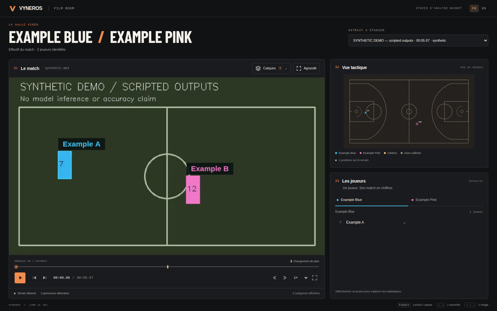
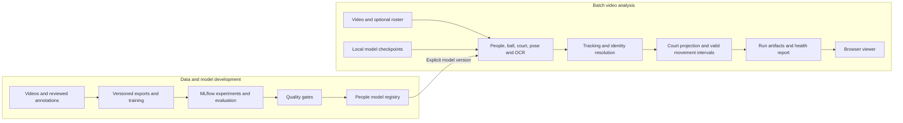
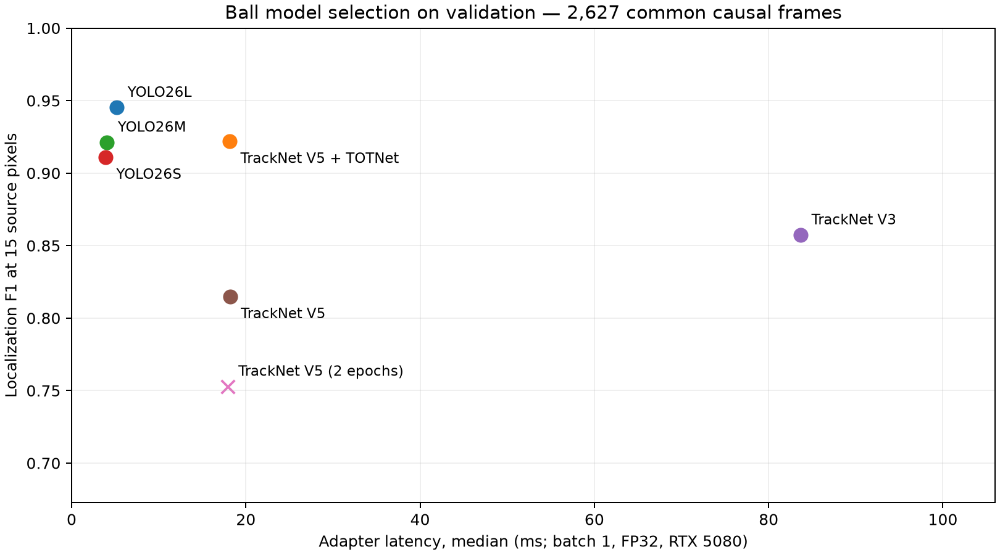

# Vyneros — Basketball Video Analytics

**From basketball footage to tracked players, court positions and inspectable movement statistics.**

Vyneros is a batch computer-vision pipeline with a browser viewer for exploring
predictions alongside the source video. It combines player and referee detection,
ball localization, court calibration and jersey recognition with a reproducible
model workflow: versioned data, tracked experiments, evaluation, controlled model
promotion and containerized inference.

**Python · PyTorch · Ultralytics · ONNX Runtime · MLflow · DVC · Docker · GitHub Actions**

[Try the viewer](#try-the-viewer) · [Architecture](#architecture) · [Results](#results) · [Model lifecycle](#model-lifecycle) · [Run inference](#run-inference)

## See it in action

> **30-second real-inference demo — coming next.**
>
> Space reserved for a clip showing tracked players and the ball, the projected
> court view, and a player’s observed movement statistics.

<!-- DEMO: Insert the public video link or a linked GIF here once reviewed.
Record clip provenance, selected model versions, source duration and processing
hardware. Identify footage used during development separately from held-out data.
Do not use the scripted sample as evidence of learned-model performance. -->

Analyses are computed before playback. The viewer reads completed run artifacts
independently of the inference process.

| Focused example | What it will show | Status |
| --- | --- | --- |
| Ball localization | A fast or partly occluded ball, with a success and a failure explained | Clip and commentary pending |
| Camera changes | A cut or unavailable calibration, with measurements interrupted at the boundary | Real example pending |
| Player identity | A verified jersey identification and abstention on an ambiguous number | Reviewed example pending |

## Try the viewer

Explore the interface with Docker, without a GPU or model downloads:

```bash
git clone https://github.com/ErwanMouras/basket-ai-analysis.git
cd basket-ai-analysis
docker compose up --build -d viewer
```

Open **http://127.0.0.1:8766**, play the sample, toggle layers and select a player.
Stop with `docker compose down`.

**The included sample is synthetic and scripted.** It exercises playback,
overlays, player statistics, player/team heatmaps and unavailable calibration. It contains no learned
predictions or NBA footage. See the [sample description](examples/demo/README.md).

<details>
<summary>Preview of the included interface sample</summary>



Basketball-inspired Film room with FR/EN controls, category overlays, player summaries
and five spatial views for players or teams: presence, movement, zones, comparison
and evolution across estimated offensive or defensive passages, with a common
basket direction. Unclassified periods remain available for video review.
The public sample is synthetic and scripted; it is not evidence of model accuracy.

</details>

For an existing Python environment, `make demo-native` serves the same sample.
See the [viewer guide](viewer/README.md) for controls and custom run folders.

## Architecture



Perception combines people detection, TrackNet or YOLO ball localization, RTMPose-M,
court landmarks and PARSeq OCR. Tracking is separated by role; identity uses
jersey numbers, roster and color evidence. Movement statistics preserve coverage
and the reasons intervals were excluded.

Local-checkpoint inference needs no MLflow server. Registry loading is optional
for people models. The integrated ball adapters support V5/V5+TOTNet and the
fine-tuned YOLO26 ball checkpoints; V3 integration remains to be implemented.
Optional people segmentation supports detector boxes prompted into SAM 2.1 or
direct YOLO26 L/X instances. The standard profile keeps bbox detection.

## Results

### Recorded detector comparison

Two existing checkpoints were evaluated on the same **401 verified validation
images** on 18 October 2026: resolution 640, FP32, batch 1, RTX 5080, five warmup
calls and three timing repeats.

| Configuration | Player AP@50:95 | Referee AP@50:95 | Adapter latency, median / P95 |
| --- | ---: | ---: | ---: |
| COCO YOLO26 Nano + E-BARD referees | 0.5154 | 0.6377 | 8.15 / 9.27 ms |
| E-BARD YOLOv8n | 0.7318 | 0.6377 | 4.46 / 5.08 ms |

These images cover roughly the first 6–7 seconds of two validation clips and are
strongly correlated in time. Both systems use the same referee weights. The
comparison supports a local selection decision; generalization to independent
matches remains to be measured. Adapter latency excludes the rest of the video
pipeline. [Protocol and recorded evidence](reports/POC_DELIVERY_2026-10-18.md).

### Ball experiments and release selection

**TrackNet V5, V5+TOTNet, V3 and YOLO26 S/M/L** were re-evaluated from their
MLflow checkpoints using a common localization task. The comparison covers
**12 saved checkpoints**, including the earlier two-epoch V5 baseline.

**Before comparing:**

1. Verify split identities, data versions and matching input pixels. A shared
   dataset ID alone does not prove that format-specific exports are equivalent.
2. Define the same output and scoring rule. Box AP and heatmap training F1
   measure different things; here every model supplies one source-image point.
3. Control temporal information and support. Use only past/current frames and
   score the same targets, then report each model's context coverage separately.
4. Freeze checkpoints, decoder thresholds, tolerance and timing conditions
   before inference. Keep unknown positions out of absent-ball negatives.
5. Select on validation, then confirm on untouched matches. Reusing validation
   for training and checkpoint choice cannot provide an independent test score.

The protocol was committed before evaluation: **2,627 common frames from two
validation matches**, 512 × 288, causal last head, **15 source-pixel tolerance**,
FP32, batch 1, RTX 5080. YOLO confidence is 0.25; the heatmap threshold is 0.5.
These are fixed decoder settings, not calibrated probabilities across families.
YOLO uses one frame, V5 three and V3 eight; temporal models score only their last head.

| Model | Localization F1 | Error median / P95 (source px) | Context coverage | Adapter median / P95 (ms) |
| --- | ---: | ---: | ---: | ---: |
| YOLO26L | 0.9451 | 3.24 / 8.14 | 100.00% | 5.19 / 5.92 |
| V5 + TOTNet | 0.9219 | 4.37 / 188.86 | 96.86% | 18.14 / 18.65 |
| YOLO26M | 0.9211 | 3.18 / 9.64 | 100.00% | 4.06 / 4.79 |
| YOLO26S | 0.9109 | 3.24 / 173.46 | 100.00% | 3.89 / 4.50 |
| TrackNet V3 | 0.8572 | 3.60 / 10.42 | 89.69% | 83.68 / 85.72 |
| TrackNet V5 | 0.8148 | 4.45 / 903.85 | 96.86% | 18.18 / 18.60 |
| V5 (2 epochs, historical) | 0.7528 | 4.71 / 783.07 | 96.86% | 17.90 / 18.51 |

Each row selects its best archived checkpoint on validation. Errors describe
returned positions; the full report preserves recall, displaced predictions and all
12 checkpoint outcomes. Latency includes preprocessing and model inference from
decoded RGB windows, excluding disk access, loading and other pipeline stages.

**Development candidate: YOLO26L `best_f1.pt` (epoch 30)** — F1 **0.9451**,
versus **0.9219** for V5+TOTNet, with about **71% lower adapter latency**.
Its single-frame ball adapter is integrated and has run on raw HOU–LAL footage
alongside E-BARD + SAM, pose, court and OCR. The dedicated
[studio profile](configs/segmentation/studio-sam-yolo26l-ball.yaml) pins the selected
checkpoint SHA-256. The standard video recipe still uses the historical V5 checkpoint.



**Scope:** validation selection on visible-ball annotations. Independent matches,
reviewed camera cuts, absent-ball negatives and localizable occlusions remain
unmeasured. Context coverage refers to the exported frames; raw-video inference
may have additional usable context. Training initialization and augmentation also
differ, so the ranking compares complete configurations at the stated settings.

[Protocol, all checkpoints, per-match results and limitations](reports/ball-comparison-2026-10-25/README.md)
· [Reproduce the comparison](training/ball/EVALUATION.md)

### Segmentation comparison and reviewed studio

Two opt-in strategies were compared on **626 verified train/validation images**
with **5,844 player boxes**, without segmentation fine-tuning: E-BARD bbox →
SAM 2.1 Tiny (players and referees), or direct YOLO26 L/X segmentation (referees
stay in detection only).

| Configuration | Player precision / recall, IoU .50 | Bbox AP@50:95, validation | Perception median (ms) |
| --- | ---: | ---: | ---: |
| E-BARD baseline | 91.21% / 95.29% | 0.7296 | 3.75 |
| E-BARD → SAM | 91.21% / 95.29% | 0.7296 | 50.53 |
| YOLO26 L segmentation | 70.93% / 90.02% | 0.7325 | 19.95 |
| YOLO26 X segmentation | 86.13% / 87.25% | 0.7617 | 28.68 |

Precision/recall use all 626 images at score .25; AP uses the 401 validation
images. Timings measure perception only, on an RTX 5080, FP32, batch 1, YOLO at
640 and SAM at 1024. SAM preserves detector boxes, scores and roles. Direct COCO
person segmentation includes extra people near the court. Masked OCR showed no
demonstrated accuracy gain; mask quality still requires reviewed mask labels.
[Protocol, per-split results, OCR and limitations](reports/segmentation-comparison-2026-10-25/README.md).

The complete **E-BARD + SAM / fine-tuned YOLO26L ball** profile processed all
**1,842 decoded HOU–LAL frames**, with all six capabilities available and no stage
errors: **318.49 s processing**, **320.94 s total**, **5.78 frames/s**. The container
declares 1,843 frames; decoding and source PTS checks both found 1,842. This is a
development clip and a specific profile, not an independent accuracy benchmark.

The studio offers **bbox, segmentation, both or hidden per category**, with
independent pose and label controls for players and referees. Masks follow the
presented video frame, including paused seeking and frame stepping. The
[display audit](reports/segmentation-display-audit-2026-10-25/README.md) documents
the corrected one-frame offset, pixel-exact RLE checks and remaining mask limits.

**Review accepted by Erwan on 26 October 2026:** visual playback, segmentation
display and category controls approved for integration. This confirms the reviewed
functionality; the comparison does not establish a segmentation/OCR accuracy gain
or promote a segmentation profile to the default.

### Full-pipeline validation to complete

| Release measurement | Status |
| --- | --- |
| Selected model quality on independent matches | Pending held-out clips and frozen evaluation |
| Tracking IDF1, identity precision and coverage | Evaluator implemented; reviewed trajectory annotations pending |
| Ground-position and observed-distance error | Evaluator implemented; independent reference measurements pending |
| Processing time for the 30-second demo | Pending final recipe, with loading and processing reported separately |

A historical full-pipeline run reached approximately **20 frames/s on an RTX
5080**. The final recipe still needs benchmarking; 30 FPS has not been
demonstrated. [Benchmark scope](pipeline/VALIDATION.md).

## Model lifecycle

An executed people-model release exercise covers **evaluation → registration →
quality-gated promotion → rejected promotion → audited rollback**. The restored
model was reloaded and used for inference.

[Acceptance decision](reports/poc-2026-10-18/accepted.json) · [Rejected decision](reports/poc-2026-10-18/rejected.json) · [Lifecycle evidence](reports/POC_DELIVERY_2026-10-18.md)

| Concern | Implementation |
| --- | --- |
| Data traceability | DVC references, paired YOLO/COCO exports, source hashes and split checks |
| Experiment tracking | MLflow parameters, metrics, configurations and checkpoint provenance |
| Model selection | Compatible completed evaluations required; configurable AP, recall and P95 latency gates |
| Deployment | Pinned dependency locks, model bundles with checksums and Docker CPU inference |
| Run diagnostics | `health.json` records integrity, availability, exclusions, timings and resources |
| Regression checks | Python suites, JavaScript syntax checks and a GitHub Actions workflow |

Local validation on **26 October 2026**: **371 Python tests passed**, 28 optional tests
skipped, plus **17 JavaScript regression tests** and syntax checking. Real-training integrations are disabled.
The pre-merge real-model check completed 30 source frames with all six capabilities
available, no stage errors and 434 valid player/referee masks. Browser checks found
no synchronization mismatch across 120 presented frames at 1×/2×, frame stepping,
delayed annotations and the fallback without video presentation callbacks.
The [CI workflow](.github/workflows/players.yml) runs the regression suites and
builds the viewer container. Run checks in the configured players environment
with a new output folder:

```bash
make check-poc CHECK_OUTPUT=runs/checks/my-change
```

Health reports describe availability and integrity; accuracy requires reviewed
annotations. The [release guide](docs/EVALUATION_AND_RELEASE.md) documents
quality policies, registry operations and rollback.

See the [review and validation report](reports/PR_REVIEW_2026-10-25.md) for the fixes, browser checks and CPU container smoke test.

## Run inference

Inference requires input footage and explicitly installed checkpoints. The
supplied profile uses CUDA; CPU setup is available below. See the
[pipeline guide](pipeline/README.md) for model paths and configuration.

<details>
<summary>Set up the local CUDA environment and analyze a clip</summary>

```bash
uv venv --python 3.12 .venv-players
uv pip sync --python .venv-players/bin/python --torch-backend cu130 \
  training/players/requirements-cu130.lock
make setup-analysis
make setup-court
make setup-players-pose
make setup-jersey
```

Install the pinned TrackNet reference and a compatible ball checkpoint, then
set `ball.weights` in `configs/analysis.yaml`. These assets are required in
addition to the setup commands above; inference does not download missing weights.

```bash
make analyze-video VIDEO=/path/to/clip.mp4 OUTPUT=runs/analysis/example
# Add ROSTER=/path/to/jersey.json for roster-based identities.
make view-analysis
```

Open **http://127.0.0.1:8765**. Each analysis needs a new output directory.
For the reviewed SAM + YOLO26L ball configuration, install the segmentation
checkpoints with `.venv-players/bin/python -m training.segmentation.setup`, then
pass `ANALYSIS_CONFIG=configs/segmentation/studio-sam-yolo26l-ball.yaml` to
`make analyze-video`. Its ball checkpoint must already exist locally at
`ball.weights` with the pinned SHA-256; see the [segmentation guide](training/segmentation/README.md).
For CPU setup, use `requirements-cpu.lock` with `--torch-backend cpu` and set each
model's device to `cpu` in the analysis configuration.

</details>

<details>
<summary>Bundle installed models and run CPU inference in Docker</summary>

```bash
make bundle-models
make verify-model-bundle
make runtime-image
make infer-container VIDEO=/path/to/clip.mp4 \
  OUTPUT=release/inference-example MAX_FRAMES=150
```

Bundle creation needs installed local models and a new bundle directory. The
container runs without network access, using read-only model and input mounts.
The recorded CPU smoke test exercised all six capabilities on a few frames;
representative CPU throughput remains to be benchmarked.

</details>

Completed runs produce inspectable, versioned artifacts:

| Output | Contents |
| --- | --- |
| `run.json` | Source, configuration, model/code provenance, timings and artifact hashes |
| `observations.jsonl` | Frame-level detections, tracks, pose, ball, court and identity evidence |
| `tracks.jsonl` | Movement contributions and reasons for excluded intervals |
| `statistics.json` | Player summaries, observed distance, measured duration and coverage |
| `health.json` | Output integrity and runtime diagnostics |

## Data and measurement scope

The current inventory contains **six train clips / 225 verified people-annotation
images** and **two validation clips / 401 verified images**. Independent test
clips are pending. Raw footage and annotations remain private; the synthetic
sample is included. See [data management](docs/DATA.md).

Distances cover valid observed intervals. Camera cuts, missing calibration,
tracking gaps and identity conflicts interrupt measurement; off-screen movement
is unobserved. Full-match distance accuracy is unverified. Court projection
applies to people; ball positions remain in image coordinates.

## Next release

The [implementation plan](docs/ROADMAP.md) tracks the remaining work and completion criteria.

- [x] Compare ball checkpoints using a common causal evaluation; select YOLO26L for integration.
- [x] Integrate the selected ball checkpoint into the video pipeline and validate on raw footage.
- [x] Compare segmentation strategies and review category-specific studio overlays.
- [ ] Publish the 30-second real-inference demo and reviewed examples.
- [ ] Add independent test clips and report tracking, identity and geometry quality.
- [ ] Publish a consistent source/data release and verify remote CI.
- [ ] Confirm the project source license and distribution terms for demo assets.

## Documentation and credits

| Topic | Guide |
| --- | --- |
| Pipeline, configuration and output contracts | [Pipeline](pipeline/README.md) |
| Training and evaluating people detectors | [Training](training/players/TRAINING.md) · [Evaluation](training/players/EVALUATION.md) |
| Ball evaluation and temporal policies | [Ball evaluation](training/ball/EVALUATION.md) |
| Segmentation strategies, masks and OCR | [Segmentation](training/segmentation/README.md) · [Comparison](reports/segmentation-comparison-2026-10-25/README.md) · [Display audit](reports/segmentation-display-audit-2026-10-25/README.md) |
| Jersey recognition and court geometry | [Jersey OCR](training/jersey/README.md) · [Court calibration](training/court/README.md) |
| Registry, release and reproducibility | [Model registry](training/players/PIPELINE.md) · [Evaluation and release](docs/EVALUATION_AND_RELEASE.md) |
| Viewer controls | [Viewer](viewer/README.md) |

Model sources and checkpoint provenance are documented in the module guides.
The vendored PARSeq subset includes its [license](training/jersey/vendor/parseq/LICENSE)
and [notices](training/jersey/vendor/parseq/NOTICE). Third-party code, weights and
footage retain their respective terms. **Project source license: to be selected.**
