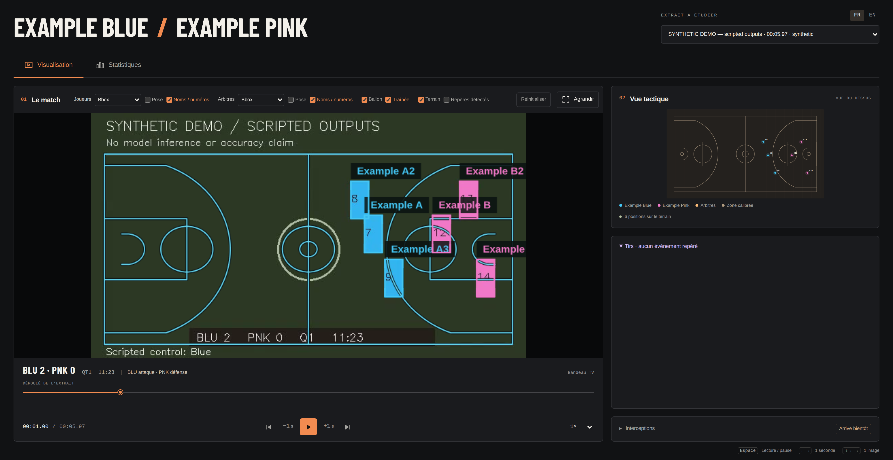
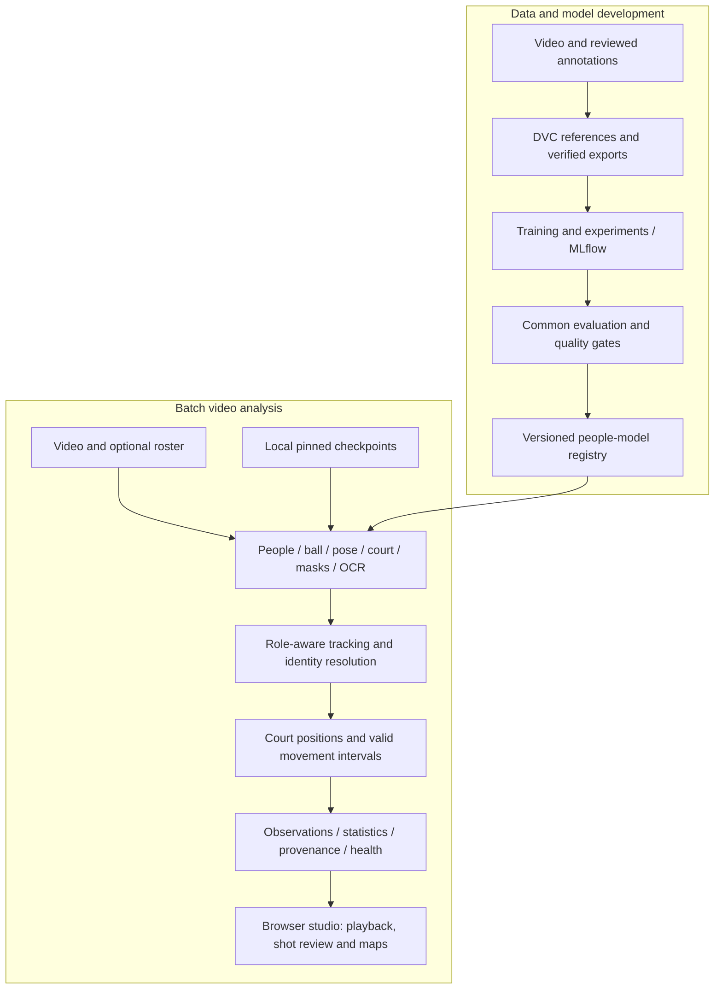

# Vyneros — Basketball Video Analytics

**From broadcast footage to basketball actions you can explore, measure and review.**

[](https://github.com/ErwanMouras/basket-ai-analysis/actions/workflows/players.yml)


Vyneros turns basketball video into tracked players, ball trajectories, court
positions and reviewable shot proposals. A browser studio connects predictions
to their source frames, so an analyst can move from a team map to a player's
attempts and inspect the evidence behind the numbers.

Built by [Erwan Mouras](https://github.com/ErwanMouras) as a **Machine Learning /
Computer Vision engineering portfolio**, the project covers annotation, model
experiments, reproducible inference, release controls and an interactive review tool.

**Python · PyTorch · Ultralytics · CUDA / Triton · OpenCV · MLflow · DVC · Docker · GitHub Actions**

[Demo](#see-the-system-in-action) · [Try the viewer](#try-the-viewer) · [Commands](#run-analyses-and-checks) · [Documentation](#explore-the-implementation) · [Results](#measured-results) · [Engineering decisions](#engineering-decisions) · [MLOps](#from-experiment-to-controlled-release) · [Roadmap](#where-i-would-take-it-next)


## See the system in action

A broadcast camera moves, cuts away and loses players behind one another.
Vyneros makes those conditions inspectable: overlays follow the presented frame,
court maps normalize attacking direction, and player measurements retain the
intervals that actually support them.

1. **Inspect the play.** Switch player/referee boxes, masks, pose and court layers
   independently, then step through the source video frame by frame.
2. **Open a player's attempts.** Jump from the player profile into a bounded shot
   review, keep synchronized overlays, and optionally include candidates.
3. **Compare the teams.** Read presence and shot-origin maps side by side, with
   attacking/defending filters and explicit reasons for missing positions.

> **Spurs–Kings walkthrough — capture pending.** A 30–40 s, captioned MP4 will
> show the completed real inference: annotated play → player shot review → team
> maps → run provenance. A silent 6–8 s GIF will provide the inline GitHub preview.
> Both will be captured after the run completes and its outputs pass review;
> playback speed will be distinguished from inference speed.

> **Two supporting visuals planned.** A wide PNG will pair an annotated source
> frame with its projected court. A second PNG will show player coverage and team
> maps with readable labels. Moments will be selected from the completed run;
> missing identities or unavailable maps will remain visible when relevant.

The [media brief](docs/demo/spurs-kings-media-brief.md) specifies formats,
storyboard, captions and selection criteria. Existing
[reviewed examples](docs/demo/evidence.md) document evidence available before this capture.

## Try the viewer

Docker is enough to explore the included **synthetic, scripted sample**.
It requires no GPU, private dataset or model download.

```bash
git clone https://github.com/ErwanMouras/basket-ai-analysis.git
cd basket-ai-analysis
docker compose up --build -d viewer
```

Open **http://127.0.0.1:8766**. Stop with `docker compose down`.
The sample demonstrates the interface and missing-data states; it contains no
learned predictions or NBA footage. [Sample contents](examples/demo/README.md).

<details>
<summary>Existing synthetic interface preview</summary>



This existing image shows the portable sample. The planned Spurs–Kings media
will show the completed real-inference run.

</details>

## Run analyses and checks

Inference requires compatible local checkpoints and input footage. The
[pipeline guide](pipeline/README.md) documents model installation, CPU/CUDA
environments and configuration. Missing weights are installed explicitly before
analysis. For the SAM + YOLO26L studio recipe, the selected ball checkpoint must
match the configured SHA-256.

The Makefile provides the main entry points. `make help` lists the available
commands. By default, viewer commands use `.venv/bin/python` and analysis/checks
use `.venv-players/bin/python`; override `PYTHON` or `PLAYERS_PYTHON` to use another
environment.

### Analyze footage

With those assets installed:

```bash
make analyze-video VIDEO=/path/to/clip.mp4 OUTPUT=runs/analysis/example \
  ANALYSIS_CONFIG=configs/segmentation/studio-sam-yolo26l-ball.yaml \
  ROSTER=/path/to/roster.json
make view-analysis
```

Open **http://127.0.0.1:8765**. Use a new output directory for each analysis.
The hybrid backend accepts analysis without `ROSTER`; native CUDA requires one.
The [pipeline guide](pipeline/README.md) also describes the native backend's
additional dependencies and execution-policy configuration.

### Run checks

In the configured players environment, run the offline suites with:

```bash
make check-poc CHECK_OUTPUT=runs/checks/my-change
```

Run JavaScript unit tests and browser checks after installing their dependencies:

```bash
npm --prefix viewer ci
npm --prefix viewer test
node viewer/node_modules/playwright/cli.js install chromium
npm --prefix viewer run test:browser
```

The sample viewer must be running on port 8766 for browser checks. The
[CI workflow](.github/workflows/players.yml) provides the complete validation setup.

### More Makefile commands

| Command | Purpose |
| --- | --- |
| `make help` | List analysis, annotation, training, evaluation and release commands |
| `make demo` | Build and start the Docker sample viewer on port 8766 |
| `make demo-native` | Serve the included sample with local Python on port 8766 |
| `make test-analysis` | Run the pipeline regression suite in the players environment |
| `make bundle-models MODEL_BUNDLE=release/models` | Package the configured local inference assets |
| `make verify-model-bundle MODEL_BUNDLE=release/models` | Verify the packaged assets and their hashes |

The [release guide](docs/EVALUATION_AND_RELEASE.md) documents model packaging and
container inference; the [Makefile](Makefile) contains the complete target list.

## Explore the implementation

| Area | Start here |
| --- | --- |
| Pipeline, native CUDA and output contracts | [Pipeline guide](pipeline/README.md) · [CUDA source](pipeline/cuda/) |
| Training, annotation and model evaluation | [People](training/players/README.md) · [Training](training/players/TRAINING.md) · [Ball evaluation](training/ball/EVALUATION.md) |
| Geometry, masks and identity | [Court](training/court/README.md) · [Segmentation](training/segmentation/README.md) · [Jersey OCR](training/jersey/README.md) |
| Data and release operations | [Data](docs/DATA.md) · [Registry](training/players/PIPELINE.md) · [Release guide](docs/EVALUATION_AND_RELEASE.md) |
| Product behavior and presentation | [Viewer](viewer/README.md) · [Media brief](docs/demo/spurs-kings-media-brief.md) |

## Measured results

### A common task made the ball models comparable

TrackNet heatmaps and YOLO boxes cannot be ranked by their training metrics alone.
I evaluated both as **one ball position in source-image coordinates**, on the same
**2,627 causal targets from two validation matches**. The protocol fixed decoder
thresholds, checkpoint policy, 15-pixel tolerance and timing conditions before evaluation.

| Configuration | Localization F1 | Error median / P95, source px | Adapter median / P95 |
| --- | ---: | ---: | ---: |
| **YOLO26L — selected** | **0.9451** | **3.24 / 8.14** | **5.19 / 5.92 ms** |
| V5 + TOTNet | 0.9219 | 4.37 / 188.86 | 18.14 / 18.65 ms |
| TrackNet V5 | 0.8148 | 4.45 / 903.85 | 18.18 / 18.60 ms |
| TrackNet V3 | 0.8572 | 3.60 / 10.42 | 83.68 / 85.72 ms |

Measured on an RTX 5080, FP32, batch 1, 512 × 288 input. Adapter latency excludes
loading, disk access and other pipeline stages. YOLO uses one frame, V5 three
and V3 eight; temporal models contribute only their final head. Common targets
have enough context for every model. The cohort covers visible balls; absent-ball
false alarms and occlusion robustness need separate evaluation.

**Decision:** integrate the selected YOLO26L checkpoint into the reviewed studio
profile. Its single-frame context also avoids temporal startup gaps after camera
cuts. The historical default recipe retains V5; the
[studio recipe](configs/segmentation/studio-sam-yolo26l-ball.yaml) pins YOLO26L by
SHA-256. [All 12 checkpoints, per-match results and protocol](reports/ball-comparison-2026-10-25/README.md).

### Detection and segmentation were selected for the task

On **401 verified validation images**, E-BARD YOLOv8n reached **0.7318 player
AP@50:95**, versus **0.5154** for the evaluated COCO YOLO26 Nano configuration.
Median adapter latency was **4.46 vs 8.15 ms** under the recorded protocol.
E-BARD supplies explicit player/referee roles used throughout the pipeline.
These are existing pretrained checkpoints; this comparison did not train either
model. [Evaluation and release evidence](reports/POC_DELIVERY_2026-10-18.md).

I also compared **detector boxes → SAM 2.1** with direct YOLO26 L/X segmentation.
SAM preserves the detector's boxes and roles, at a higher processing cost. Direct
segmentation offers another speed/quality tradeoff, but its generic person class
also includes people near the court. Segmentation stays configurable; mask and
OCR accuracy need their own reviewed labels.
[Segmentation study](reports/segmentation-comparison-2026-10-25/README.md).

### Error analysis changed the system

A plausible ball flight can be assigned to the wrong nearby hand. Reviewing a
GSW–DEN event exposed a shot attributed to a defender. I added a context check
that removes a shooter when court direction or a confirmed opposing settled
attack contradicts the assignment. Across that development run, **14 unsupported
attributions were removed while all 223 event proposals remained reviewable**.

The same investigation led to foreground-only jersey color sampling and
mask-aware crop overlap checks. This is the feedback loop behind the viewer:
inspect a failure, identify its cause, update the rule, and protect the behavior
with regression tests. [Cases, counts and limitations](reports/segmentation-shot-context-2026-10-28/README.md).

## Engineering decisions

| Problem | Decision and rationale | Evidence |
| --- | --- | --- |
| Different model families expose incompatible scores | Normalize the output task, freeze evaluation settings and report context coverage alongside quality. | [Ball evaluation](training/ball/EVALUATION.md) |
| Camera motion makes pixel displacement misleading | Estimate court homographies, use observed foot positions and break measurement across cuts, gaps or invalid calibration. | [Court](training/court/README.md) · [Distance logic](pipeline/distance.py) |
| A jersey number may belong to both teams | Combine repeated OCR with roster and uniform evidence; keep conflicting identities unresolved and reject simultaneous collisions. | [Identity resolution](pipeline/identity.py) |
| GPU models leave substantial work on the host | Implement native CUDA decoding, preprocessing, geometry, tracking and aggregation, with graph capture and Triton kernels where applicable. | [CUDA source](pipeline/cuda/) · [Parity and resume tests](pipeline/tests/test_cuda_optimizations.py) |
| A polished overlay can hide a data error | Synchronize with presented timestamps, verify artifact hashes and expose uncertain events, excluded intervals and coverage. | [Viewer](viewer/README.md) · [Contracts](pipeline/contracts.py) |

**My engineering contribution:** annotation/export tools, experiment and evaluation
workflows, model adapters, identity and spatial logic, CUDA execution, artifact
contracts, release tooling, tests and the browser studio. Reused neural
foundations are credited below; ball training campaigns are documented in the
[comparison report](reports/ball-comparison-2026-10-25/README.md).

## Architecture



Two execution paths share the analysis purpose. The **hybrid backend** supports
the existing adapters and records device fallback. The **native CUDA backend**
uses NVDEC and CUDA computation through final statistics, with CPU tensor
arithmetic rejected at runtime. It currently requires the supported YOLO,
SAM box-prompt and explicit-roster configuration on one CUDA device.

The native path includes a CUDA execution implementation of the pinned RTMPose
ONNX graph, CUDA streams and captured model calls. Custom GPU kernels written
with **Triton**, a Python-like GPU programming language and compiler, keep tracking
and geometry computations on the GPU.
Progress covers postprocessing and integrity checks as well as video inference.
Resume retains complete camera segments and replays the final segment to
reconstruct state. [Execution policies, setup and resume](pipeline/README.md).

## From experiment to controlled release

The people-model lifecycle has been exercised end to end:

**Evaluate → register → promote → reject a regression → roll back → reload and predict.**

The [accepted](reports/poc-2026-10-18/accepted.json) and
[rejected](reports/poc-2026-10-18/rejected.json) decisions record the compared
checkpoints and checks. Promotion requires compatible completed evaluations;
the [policy](configs/quality_gates.yaml) checks reviewed-image support, AP/recall
regression and P95 adapter latency. Alias changes record the expected previous
version and a reason. The rollback exercise reloaded the restored model and ran
inference. [Recorded lifecycle](reports/POC_DELIVERY_2026-10-18.md).

- **Data lineage:** DVC references for private inputs, match-aware split checks,
  verified YOLO/COCO exports and source hashes.
- **Experiment lineage:** MLflow parameters, metrics, configurations and
  checkpoint provenance; evaluation reports identify their data and protocol.
- **Portable execution:** separate pinned CPU/CUDA environments, verified local
  model bundles and containerized CPU inference exercised without network access.
- **Inspectable outputs:** each run links source, configuration, model/code
  fingerprints, timings and artifact hashes. Health reports check integrity and
  describe availability; they complement accuracy evaluation.

| Artifact | What it lets a reviewer inspect |
| --- | --- |
| `run.json` | Which video, models, configuration and code produced the run |
| `observations.jsonl` | Frame-level detections, pose, masks, calibration and identity evidence |
| `tracks.jsonl` | Movement contributions and reasons for excluded intervals |
| `statistics.json` | Observed distance, measured duration and coverage per subject |
| `health.json` | Integrity checks, capability availability and diagnostics |

The [release guide](docs/EVALUATION_AND_RELEASE.md) covers reproduction,
quality gates, registry operations and rollback.

## Testing and reliability

Checks cover numerical behavior, generated artifacts and the browser workflows
used to inspect an analysis.

- **Pipeline correctness:** CPU/CUDA regression tests, numerical comparisons
  with reference implementations, and timestamp, identity and artifact-integrity
  checks on real-video runs.
- **Viewer behavior:** playback, frame stepping, synchronized overlays, shot
  review and maps, with browser checks for responsive layouts, keyboard use,
  accessibility, localization and delayed responses.
- **Reproducible checks:** GitHub Actions runs offline regression and Chromium
  suites, builds the viewer Docker image and verifies its imports, assets and
  public sample. CUDA-specific tests and real-video checks also run locally.

See the [CI runs](https://github.com/ErwanMouras/basket-ai-analysis/actions/workflows/players.yml),
[release validation report](reports/POC_DELIVERY_2026-10-18.md) and
[CUDA refinement audit](reports/sac-sas-identity-audit-2026-10-28/COLORS.md)
for detailed evidence. These checks establish technical reliability on the tested
cases; model accuracy requires separate evaluation against reviewed annotations.

## Current scope and evaluation priorities

Vyneros is a batch-analysis POC: the viewer plays completed analyses, with runtime
reported separately from playback. Model latency, full-pipeline throughput and
output accuracy are distinct measurements.

The recorded people-data inventory contains **six training clips / 225 verified
images** and **two validation clips / 401 verified images**. Those validation
images are temporally correlated. The ball comparison uses its separately
documented cohort. Private footage and annotations are managed outside Git;
the public sample is synthetic.

Identity coverage, tracking continuity and geometry accuracy remain the key
evaluation priorities. Distances describe valid observed intervals; off-screen
movement is unmeasured. Ball positions remain in image coordinates. Shot events
are probable/candidate proposals, with made/missed outcomes left unassigned.
The [gold evaluator](mlops/gold.py) supports tracking, identity and geometric
checks; independent reviewed annotations are still needed to publish those scores.

## Author and foundations

**[Erwan Mouras](https://github.com/ErwanMouras)** — project design, ML/CV
integration and MLOps engineering. For a technical discussion, the model
comparison, native CUDA path and release lifecycle are three useful starting points.

Vyneros builds on Ultralytics YOLO, the E-BARD player/referee checkpoint,
TrackNet/TOTNet, SAM 2.1, RTMPose and PARSeq. Model sources, pinned weights and
provenance are documented in their module guides. The vendored PARSeq subset
includes its [license](training/jersey/vendor/parseq/LICENSE) and
[notices](training/jersey/vendor/parseq/NOTICE). Third-party code, weights and
footage retain their respective terms. A project-wide source license has not
yet been designated.

## Where I would take it next

### Near-term improvements — small scope, immediate value

- **Publish the real-run visual story.** Complete the Spurs–Kings review, select
  representative moments and attach the captioned walkthrough, stills and exact
  configuration. Success: the main result is understandable without installation.
- **Make the preferred inference recipe portable.** Add a checked-in native CUDA
  configuration template and model-asset checklist, then verify them from a clean
  checkout. Success: configuration and missing-asset errors are actionable.
- **Consolidate the performance report.** Separate loading, perception, identity
  processing, statistics and health checks for the completed native run. Success:
  speed claims identify their workload, hardware and measurement boundary.
- **Package a coherent portfolio release.** Refresh older scope/roadmap documents,
  designate the source license and publish a tagged source release with its
  validation evidence and asset terms.

### Core reliability — high impact, substantial engineering

- **Build an independent evaluation set.** Review unseen matches, camera cuts,
  absent-ball negatives and persistent player identities. Publish per-match
  detection/localization, IDF1, identity precision/coverage and geometric error.
- **Improve identity continuity through occlusion and cuts.** Combine tracklet
  association, appearance and jersey evidence, measuring false associations as
  carefully as coverage. Preserve the current collision and abstention safeguards.
- **Validate geometry and movement estimates.** Use independent landmarks and
  reference trajectories, quantify uncertainty and measure distance error only
  where the reference supports it.
- **Evaluate shot and phase inference separately.** Annotate releases, shooters
  and settled-play intervals, then measure event timing, false alarms and
  attribution before expanding the statistics.
- **Optimize complete CUDA workloads.** Benchmark repeated runs across resolutions
  and clip lengths, profile synchronization/memory costs and verify numerical
  behavior when changing kernels or model execution.

### Longer-term exploration — broader product and research scope

- **Cross-broadcast generalization:** additional scoreboards, arenas and camera
  styles, followed by other court geometries and competitions.
- **Richer game understanding:** evaluated possessions, passes, shot outcomes and
  tactical sequences once tracking and event evidence support them.
- **A hosted analysis workflow:** queued GPU jobs, access-controlled artifacts,
  cost tracking and drift monitoring when there is a concrete deployment need.
- **Streaming analysis:** bounded-latency processing and incremental review,
  after offline quality and resource budgets are established.
