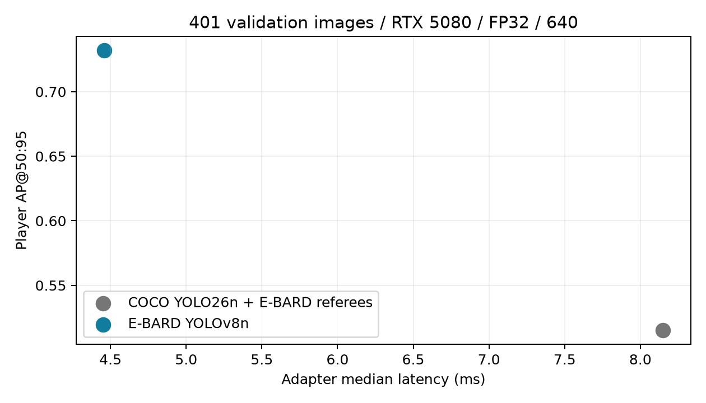

# Livraison technique du POC — 18 octobre 2026

Travail exécuté sans entraînement de modèles et sans modification des annotations
sources. Les tests utilisent leurs fixtures temporaires ; les exemples publiables
sont entièrement synthétiques et scriptés.

## Résultats techniques vérifiés

- **328 tests réussis, 27 optionnels ignorés**, soit 355 tests découverts, plus
  vérification syntaxique JavaScript. Les intégrations d'entraînement sont
  explicitement désactivées par le runner. Le résumé est dans
  `runs/ci-poc-2026-10-18-final/summary.json`.
- Démo Docker sur `http://127.0.0.1:8766`, avec vidéo H.264, overlays, sélection de
  joueur, projection et calibration indisponible. Le contrôle navigateur a
  vérifié la lecture et le bouton ballon, sans erreur JavaScript.
- Image Docker CPU construite depuis un lock de 51 distributions et une image
  Python épinglée par digest. Une analyse réelle avec les six capacités a terminé
  sans réseau sur trois frames ; une exécution finale de six frames et les
  artefacts associés sont conservés sous `release/container-output/`.
- Modèles locaux copiés dans `release/models`, contrôlés par SHA-256, avec
  configuration CPU portable et référence TrackNet épinglée. Les poids privés
  ne sont pas ajoutés à l'archive source.
- Bilan d'intégrité et de disponibilité ajouté automatiquement aux nouvelles
  analyses dans `health.json`, lui-même référencé par empreinte dans le manifeste.
- Évaluateurs gold implémentés et testés analytiquement : IDF1, changements d'ID,
  fragmentation, précision/couverture/abstention d'identité, repères terrain
  indépendants, erreurs de position, erreurs de coupe et distance sur intervalles
  communs. Aucun score réel n'est inventé en l'absence de gold revu.
- Recettes finales joueurs, ballon et gold liées aux contenus par gel. Les lecteurs
  d'entraînement ballon refusent toujours test par défaut. La politique causale
  réinitialise le contexte aux coupes explicitement fournies.

## Cycle de registre exécuté avec deux checkpoints existants

Base indépendante : `runs/mlops-acceptance-2026-10-18/mlflow.db`.
La base MLflow préexistante du projet n'a pas été remplacée.

1. Évaluation de YOLO26 Nano COCO avec arbitres E-BARD et d'E-BARD YOLOv8n sur le
   même export val et le même protocole.
2. Enregistrement des versions 1 et 2, puis acceptation de la baseline initiale.
3. Promotion de la version 2 après réussite des critères qualité.
4. Refus d'une promotion de la version 1 contre la version 2, sans changement d'alias.
5. Retour arrière opérationnel explicite vers la version 1, avec sa référence
   d'acceptation initiale et une nouvelle trace d'audit.
6. Rechargement de l'alias restauré et exécution d'une prédiction : 11 détections.

Une analyse intégrée distincte a aussi chargé explicitement la version 2 E-BARD
et terminé six frames avec les six capacités :
`runs/analysis/mlops-registry-2026-10-18-v2/`.
Les poids COCO `person` sont refusés comme source de rôles joueur pour cette
analyse ; les scores de la baseline COCO restent des mesures de détection locales.

Les décisions lisibles sont publiées dans
[accepted.json](poc-2026-10-18/accepted.json),
[rejected.json](poc-2026-10-18/rejected.json) et
[acceptance_summary.json](poc-2026-10-18/acceptance_summary.json).

## Mesures de détection

401 images val vérifiées, 3 759 boîtes joueur et 969 arbitres, RTX 5080,
résolution 640, FP32, batch 1, cinq warmups, trois répétitions.
Les images couvrent les premières 6–7 secondes de deux clips : elles sont
temporellement corrélées. Aucun test indépendant n'est revendiqué.

| Configuration | AP joueur @50:95 | AP arbitre @50:95 | Latence adaptateur médiane / P95 |
| --- | ---: | ---: | ---: |
| YOLO26 Nano COCO + arbitres E-BARD | 0,5154 | 0,6377 | 8,15 / 9,27 ms |
| E-BARD YOLOv8n | 0,7318 | 0,6377 | 4,46 / 5,08 ms |

Les arbitres utilisent les mêmes poids dans les deux chaînes. Ce tableau compare
les systèmes évalués, sans isoler une supériorité architecturale générale.
Les métriques par classe et match, IDs de runs, protocoles et empreintes figurent
dans [players_metrics.csv](poc-2026-10-18/players_metrics.csv) et
[players_comparison.json](poc-2026-10-18/players_comparison.json).

## Ballon causal

Checkpoint V5 existant du run `1edd81e040564da2bfa36a757fb855f7`, deux epochs.
Évaluation `cd8c704c1fa34f38b43dae78fc976a6d`, politique `causal_last`, seuil 0,5,
tolérance 15 pixels source, sans vidéo de revue ni entraînement.

| Mesure | Résultat |
| --- | ---: |
| Frames val exportées | 2 928 |
| Frames avec contexte causal | 2 836 |
| Couverture | 96,8579 % |
| Précision | 0,8169 |
| Rappel | 0,6999 |
| F1 | 0,7539 |
| Erreur médiane des paires localisées | 4,71 px source |
| Erreur P95 des paires localisées | 777,61 px source |

Les erreurs importantes restent incluses dans la distribution. Les positions
inconnues sont exclues par la politique d'export actuelle ; les coupes revues
n'ont pas été fournies. Les trous de l'export coupent le contexte. Cette mesure
valide la causalité du décodage sur l'export, pas toute la segmentation caméra
du pipeline ni les fausses alertes en absence certaine de ballon.

Voir [les métriques](poc-2026-10-18/ball_causal_metrics.json) et
[le protocole gelé de cette exécution](poc-2026-10-18/ball_causal_protocol.json).

## Publication et reproduction

Le README présente les parcours Docker et les résultats effectivement mesurés.
Les guides Markdown, locks, schémas, workflows et notices ne sont plus masqués
par une exclusion globale. `examples/demo` permet de lancer le viewer depuis les
seuls fichiers source, sans accès aux vidéos privées ou aux poids.

Le workflow CI couvre training, pipeline, viewer, scripts, configurations,
packaging et MLOps. Il a été vérifié localement ; aucune exécution GitHub distante
ni publication du workspace n'a été effectuée.

Archive opérationnelle vérifiée depuis une extraction propre : **310 fichiers
contrôlés**, image viewer reconstruite, API et lecture vidéo par requête Range
fonctionnelles, sans dataset privé, poids appris ou configuration locale.
Voir [clean_source_validation.json](poc-2026-10-18/clean_source_validation.json).
L'archive finale se trouve dans `release/vyneros-source-2026-10-18.tar.gz` ; son
manifeste lie les fichiers exacts, y compris les outils et rapports de livraison.

Une courte capture des prédictions réelles du run HOU/LAL existant est disponible
localement dans `release/private-demo/real-model-demo.mp4`, avec capture d'écran
et manifeste. Elle est exclue de la release source partageable. La démo publique
reste la scène synthétique explicitement marquée.

## Ce qui reste dépendant des données et des choix du mainteneur

- Finir la revue humaine et constituer des matchs test indépendants.
- Réaliser les campagnes d'entraînement prévues et leur sélection sur val.
- Mesurer réellement tracking, identité, géométrie et distance sur gold revu.
- Arrêter les seuils métier, confirmer la licence source et les droits de
  redistribution des poids/vidéos avant les distributions concernées.
- Publier les changements pour déclencher la CI distante ; choisir ensuite
  l'hébergement public éventuel.

Les contrôles techniques livrés ne démontrent ni 30 FPS, ni des distances de
match exactes, ni une identification nominative suffisamment couvrante.
