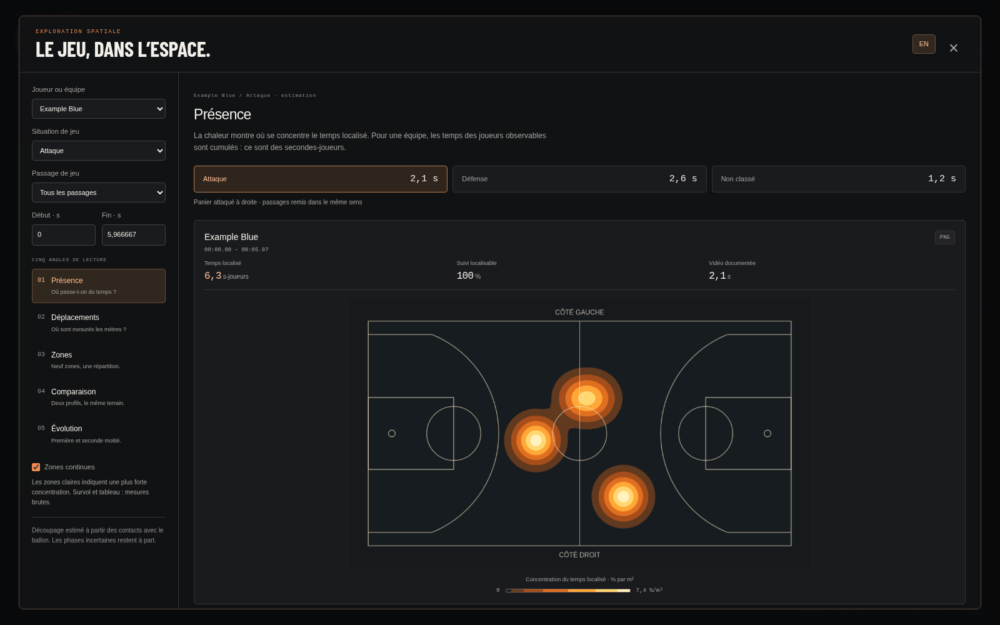
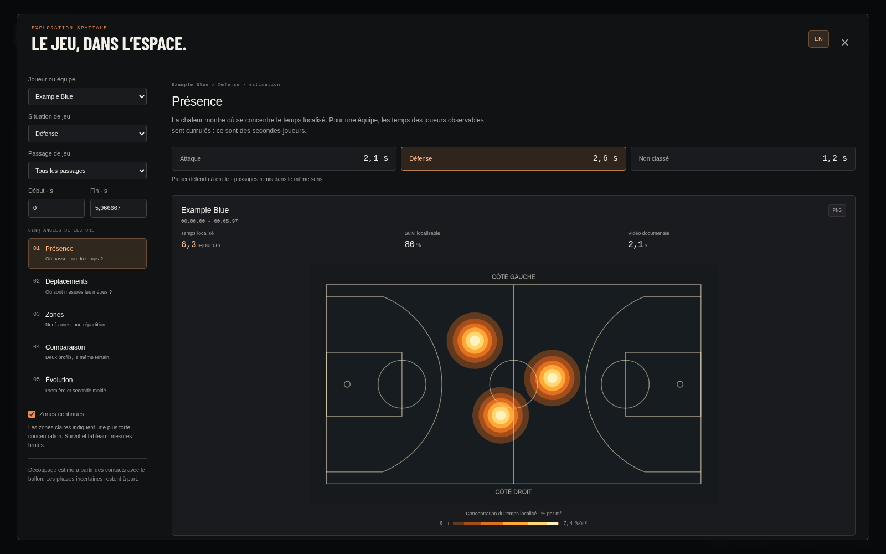
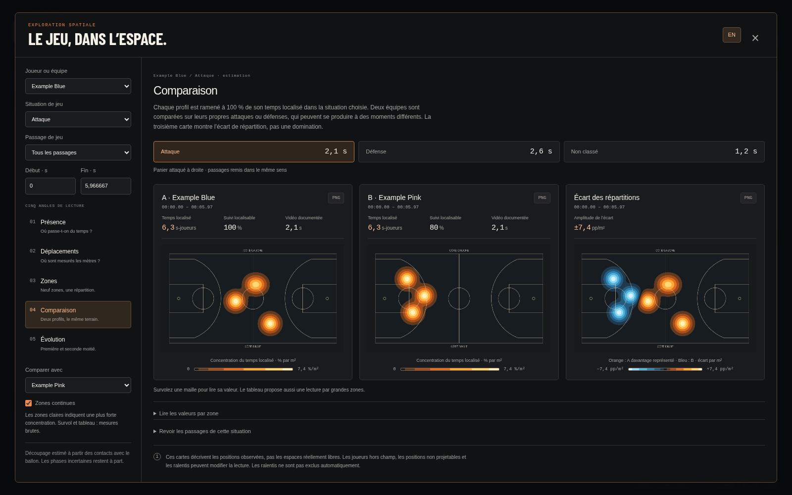
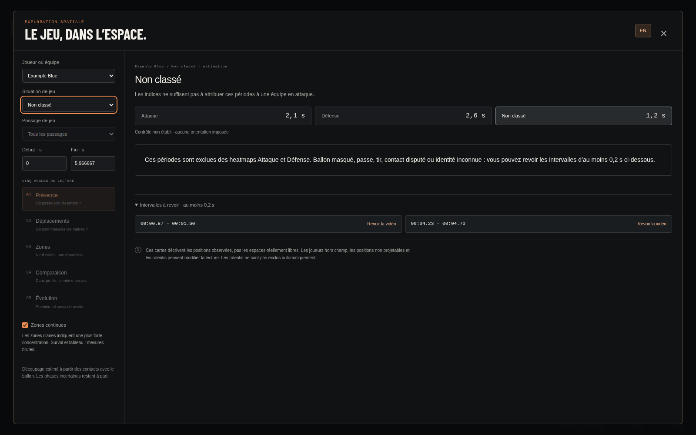

# Heatmaps par situation de jeu — 26 octobre 2026

> Étape initiale du découpage Attaque / Défense. Le [complément quart-temps et score](../quarter-score-2026-10-26/README.md)
> remplace ensuite l’orientation locale par un repère conservé sur le QT quand le bandeau est lisible.

Le viewer découpe maintenant l’extrait en **Attaque**, **Défense** et **Non classé**,
relativement à l’équipe du sujet choisi. Les cinq vues existantes cumulent par
défaut les passages de la situation sélectionnée. Le plan caméra reste une
frontière technique pour le suivi et le sens du terrain ; il n’est plus le filtre
principal présenté à l’analyste.

Le rendu par zones continues et contours nets est conservé. Les données source
HOU–LAL n’ont pas été modifiées et aucune inférence n’a été relancée.

## Expérience réalisée

Quatre approches ont été comparées sur les artefacts existants de HOU–LAL :

| Approche | Décisions sur 19 instants avec contexte visuel attribuable | Accord / désaccord | Abstentions |
| --- | ---: | ---: | ---: |
| Zone seule : équipe la plus éloignée du panier de la moitié occupée | 10 | 7 / 3 | 9 |
| Contact mains–balle instantané, avec blocage des contacts ambigus | 8 | 8 / 0 | 11 |
| Proximité corporelle avec confirmation temporelle | 8 | 8 / 0 | 11 |
| Mains–balle avec confirmation temporelle et repli corporel prudent | 10 | 10 / 0 | 9 |

La revue a examiné **21 images espacées de trois secondes**, entre 0 et 60 s :
19 avec un contexte d’attaque attribuable, deux gros plans non classables. Aucune
approche n’a attribué une attaque sur ces deux gros plans. La méthode fondée sur
la zone s’est trompée à 21, 39 et 45 s, notamment lors d’une remise en jeu ou d’une
progression depuis le camp arrière.

**Cette revue n’est pas une mesure indépendante de précision.** Elle est petite,
réalisée sur l’extrait de développement et porte sur des instants, pas sur les
frontières exactes de possessions. Elle ne justifie pas une annonce de « 100 % de
fiabilité ». Les tirs en vol peuvent conserver un contexte offensif identifiable
pour la revue visuelle, tout en restant inconnus pour l’estimateur automatique.
Les [points de contrôle](review-checkpoints.json) et [résultats complets](experiment.json)
sont publiés sans images ou vidéo NBA.

Sur les **61,37 s** de l’extrait, les deux approches temporelles donnent :

| Approche | Temps classé | Temps non classé | Temps avec sens exploitable |
| --- | ---: | ---: | ---: |
| Corps + temps | 24,33 s | 37,03 s | 17,30 s |
| Mains / corps + temps, retenue | **34,80 s** | **26,57 s** | **34,80 s** |

Pour Houston, la méthode retenue attribue **22,20 s à l’attaque** et **12,60 s à la
défense**. Les Lakers ont les durées inverses. Ce sont des secondes de vidéo
classées, pas des secondes-joueurs ni des pourcentages de possession officiels.
Les absences et les frontières non attribuables restent dans Non classé.

## Méthode retenue

1. **Contact en pixels source.** Le ballon doit être détecté avec une confiance
   d’au moins 0,35. La proximité aux poignets COCO 17 valides est rapportée à la
   hauteur du joueur. Sans poignets utilisables, un contact corporel plus
   restrictif peut servir de repli. Les équipes attribuées par le pipeline sont
   respectées ; une résolution finale nulle n’est pas remplacée par une lecture
   causale périmée.
2. **Compétition entre contacts.** Les adversaires, personnes non attribuées et
   arbitres ne disparaissent pas du calcul. Un rival trop proche ou un contact
   non attribuable bloque la décision. La balle élevée n’est pas projetée sur le
   terrain au moyen de l’homographie du sol.
3. **Confirmation temporelle.** Fenêtre de ±0,4 s, soutien d’au moins 0,16 s sur plusieurs images,
   accord d’au moins 80 % des contacts attribués. Les longs trous, coupes
   détectées, exclusions et frames manquantes ne sont pas franchis. Ces seuils
   sont des réglages heuristiques, pas des probabilités de justesse.
4. **Sens estimé séparément.** Un porteur dans la partie intermédiaire du terrain
   et au moins deux défenseurs localisables peuvent fournir un indice de panier.
   Les contacts près d’une ligne de fond n’établissent pas le sens : ils peuvent
   correspondre à une remise en jeu sous son propre panier. Les indices doivent
   cumuler au moins 0,25 s et 80 % d’accord dans le plan ; sinon le sens reste
   inconnu. Les durées de soutien et accords sont conservés dans les métadonnées.
5. **Repère commun pour les cartes.** Si nécessaire, rotation de 180° des positions
   des joueurs : panier attaqué à droite en Attaque, panier défendu à droite en
   Défense. Les distances et les contributions temporelles restent inchangées.
   Une situation connue sans sens établi ne contribue pas à la carte cumulée.

Les passages affichés peuvent réunir de courts trous inconnus de 0,6 s au maximum
entre deux portions attribuées à la même équipe et au même plan. **Ces trous ne
sont pas reclassés ni utilisés dans les heatmaps.** Il s’agit de plages pratiques
pour la revue vidéo, pas d’un nombre de possessions.

## Lecture de l’interface

- **Situation de jeu** remplace le plan caméra comme filtre principal. Tous les
  passages de cette situation sont cumulés par défaut, pour un joueur ou l’équipe.
- **Passage de jeu** et bornes temporelles permettent de cibler un moment. La barre
  de durées permet aussi de passer rapidement entre Attaque, Défense et Non classé.
- **Non classé** propose les intervalles d’au moins 0,2 s à revoir dans la vidéo,
  sans inventer de heatmap orientée. La vidéo reste en pause après le saut.
- Les cartes indiquent leur panier de référence. Les tableaux nomment les tiers
  par rapport à ce panier, avec côtés gauche / droit en regardant vers lui.
- La couverture du suivi localisable reste distincte de la durée de la situation.
  Elle ne mesure ni les joueurs hors champ ni la précision des étiquettes de phase.
- En comparaison, chaque sujet est évalué dans **sa propre** situation : les deux
  attaques peuvent correspondre à des moments différents. Une fenêtre limitée à
  l’attaque d’une équipe peut laisser l’autre carte vide. L’évolution conserve la
  situation choisie dans les deux moitiés égales de la période source.
- FR/EN, tableaux, exports PNG et rendu par contours restent disponibles.

## Aperçus du sample public

Le sample a été régénéré avec **trois joueurs par équipe**, des poignets et contacts
scriptés, des changements de contrôle dans chaque plan, une interruption du ballon
et une inversion du terrain dans le second plan. La vidéo, les observations et les
statistiques ont été régénérées ensemble et leurs hashes sont cohérents. Le libellé
visible « Scripted control » explique le scénario, sans être lu par l’estimateur.
Il ne s’agit toujours pas de prédictions de modèles ou d’une preuve de précision.









Les aperçus HOU–LAL restent locaux dans le dossier ignoré `release/phase-review/`.

## Reproduire

```bash
python -m viewer.phase_experiment \
  --run runs/analysis/hou-lal-sam-yolo26l-ball \
  --review-checkpoints reports/attack-defense-2026-10-26/review-checkpoints.json \
  --output release/phase-experiment.json
```

Les points de contrôle sont liés au hash de la source HOU–LAL. Pour un autre run,
ommettre `--review-checkpoints`, par exemple avec `--run examples/demo/runs/synthetic`.
Le comparateur lit les fichiers existants sans entraînement, inférence ou mutation
du run. Le [guide du viewer](../../viewer/README.md#heatmaps--cinq-angles-à-comparer)
décrit les contrôles et les dénominateurs.

## Validation

- **406 tests Python réussis, 28 optionnels ignorés** sur 434 découverts.
  Parmi les ajouts : 14 tests de segmentation et de cartes orientées, un scénario
  HTTP traversant deux plans, et un contrôle des changements scriptés du sample.
  Résultats locaux : `runs/checks/attack-defense-final-2026-10-26/`.
- **26 tests JavaScript réussis**, syntaxe des quatre modules vérifiée.
- Chromium : cinq modes × joueur / équipe × attaque / défense ; conservation
  des totaux, changement de passage, bornes temporelles, FR/EN, PNG, comparaison
  sans données, réponses tardives et retour à la vidéo depuis Non classé.
- Huit résolutions du lecteur et six tailles de la fenêtre ; aucune violation
  automatisée axe-core sur les états vérifiés. Ces contrôles ne constituent pas
  une certification de tous les navigateurs ni un audit manuel complet.
- Image Docker construite ; scénarios navigateur exécutés contre le conteneur
  en lecture seule, sans nouvelle dépendance ML.

## Limites et suite de la revue

La détection de balle, les poignets, les identités d’équipe et la calibration
peuvent se tromper. Des coupes dans le montage peuvent manquer au détecteur de
plans. Une remise en jeu ou une progression dans le camp arrière peut être classée
comme attaque ; aucune catégorie « attaque placée » n’est prétendue ici. Les tirs,
balles libres, arrêts de jeu et ralentis ne sont pas reconnus comme événements
fiables. Les ralentis ne sont pas exclus automatiquement. Une période non classée
ne signifie pas une absence de jeu.

Une annotation temporelle indépendante, portant aussi sur les transitions et les
frontières de possession, sera nécessaire avant de publier des statistiques de
possession ou un score de précision. Cette livraison propose une première découpe
expérimentale à examiner ; la PR reste ouverte et le merge attend la validation
d’Erwan.
