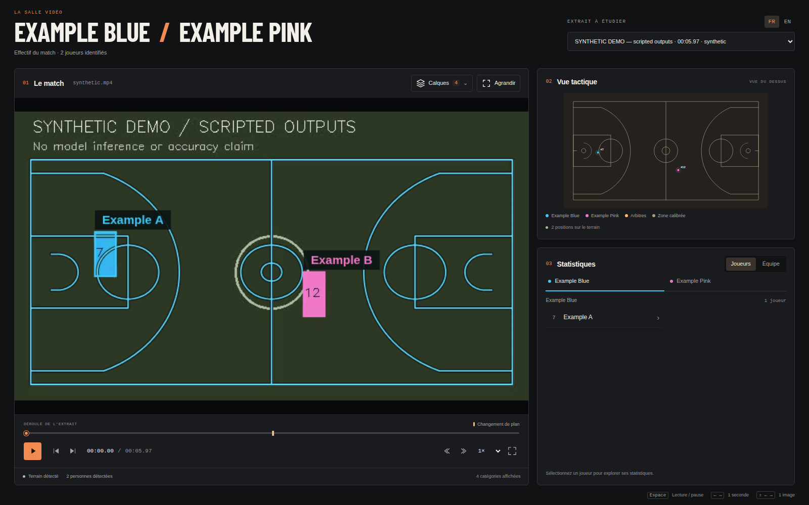

# Terrain — revue avant merge du 26 octobre 2026

Le viewer ne dessinait que des points isolés sur les images où le détecteur
passait. Entre deux détections, le terrain disparaissait visuellement malgré une
calibration suivie disponible. Les recalages directs pouvaient également faire
sauter les lignes d'une image à l'autre.

Cette PR ajoute les lignes projetées par défaut et un lissage des recalages
compensé par le mouvement de caméra. **Le merge attend la revue d'Erwan.**

## Résultat à regarder

Dans la session locale ayant produit ce rapport :

- [Page avant/après et trois vidéos comparatives](http://127.0.0.1:8770/).
- [HOU/LAL après, dans le viewer](http://127.0.0.1:8768/?run=hou-lal-1800-after).
- [POR/SAS après](http://127.0.0.1:8768/?run=por-sas-1500-after).
- [PHX/OKC après](http://127.0.0.1:8768/?run=phx-okc-1800-after).

La page compare d'abord **l'affichage seul**, avec exactement les mêmes images
et calibrations HOU/LAL avant/après, aux frames 100, 101, 600, 601 et 1000. Le
mode avant active explicitement l'ancien calque de repères. Elle propose ensuite
les **calibrations avant/après**, dessinées de façon identique côte à côte dans
les vidéos pour isoler l'effet du lissage. Les six runs du viewer contiennent
seulement le terrain, sans positions ni statistiques joueur copiées d'un ancien
calcul. Les sources et artefacts de matchs restent dans les dossiers locaux
ignorés par Git : `release/court-review/` et `runs/court/validation/`.

L'image versionnée ci-dessous utilise exclusivement le sample **synthétique et
scripté** du dépôt ; elle illustre l'affichage, pas la précision du détecteur.



## Affichage

- Lignes NBA cyan avec contour sombre, sous les calques des personnes et du
  ballon. La zone du support des repères est légèrement teintée ; les lignes
  au-delà sont extrapolées et ne constituent pas une mesure de précision.
- Apparence identique pendant une détection directe et le suivi. Changer la
  couleur ou les pointillés toutes les cinq images produisait un clignotement
  en lecture ; cette variante a été écartée. L'état sous la vidéo distingue
  toujours terrain détecté, suivi et indisponible.
- Deux options indépendantes : **Lignes projetées** activées par défaut et
  **Repères détectés** masqués par défaut. Les repères de l'image courante sont
  numérotés ; ceux d'un recalage accepté sont cyan, les autres rose. Le seuil
  d'affichage des repères est 0,5 et les points hors image sont ignorés.
- Une calibration absente, singulière, non finie ou traversant l'horizon ne
  produit pas de lignes. Aucun repère ancien n'est prolongé entre deux images.
  Le compteur de catégories et la remise à zéro incluent le terrain. FR/EN et
  les anciens runs restent utilisables sans modifier leurs artefacts.

## Calibration

Le mouvement Lucas–Kanade transporte déjà la calibration précédente dans
l'image courante. Lorsqu'un nouveau recalage absolu passe les contrôles
existants, les projections des repères retenus sont mélangées entre cette
prédiction et le recalage direct, puis une homographie est ajustée.

Le poids de la nouvelle observation vaut `1 − exp(−dt / tau)`, avec le temps
source depuis le dernier recalage et `court.smoothing_seconds: 0.15` par défaut.
Le réglage `0` désactive le lissage. Les coefficients des matrices ne sont pas
moyennés et aucune image future n'est utilisée.

Le résultat conserve le seuil de reprojection existant, le contrôle de
singularité, d'horizon et d'orientation. S'il échoue, le recalage direct est
conservé. Une coupe, un mouvement insuffisant ou une calibration expirée empêche
le mélange. Seul un recalage absolu accepté renouvelle l'âge de calibration :
le lissage ne prolonge pas la limite de propagation de 0,5 s.

Les diagnostics ajoutent `smoothing_applied`, `smoothing_alpha`,
`stabilized_reprojection_rmse_px`, `correction_median_px` et
`output_correction_median_px` aux recalages concernés. La RMSE brute existante
reste celle du recalage direct.

## Comparaison réelle : 5 100 images, 170 secondes

Les trois sources et prédictions historiques sont les mêmes que dans
[la validation terrain](../../training/court/VALIDATION.md). Le script rejoue les
deux variantes avec les mêmes personnes détectées, timestamps, points du
terrain, paramètres et graines RANSAC. Les points du détecteur sont mis en
commun ; une prédiction supplémentaire a été nécessaire sur HOU/LAL après la
perte d'une image calibrée. Les autres points viennent du cache historique.
Les empreintes des vidéos sont revérifiées. Le replay sans lissage reproduit
exactement les comptages et coupes de la validation historique.

La **correction** est la médiane, en pixels source 1080p, du déplacement des
repères retenus entre la calibration propagée à l'image courante et celle
publiée lors d'un recalage. On rapporte sa médiane et son percentile 95 sur
les recalages disposant d'une propagation comparable : 270, 262 et 277 cas.

| Extrait | Images | Correction médiane avant → après | P95 avant → après | Couverture avant → après |
| --- | ---: | ---: | ---: | ---: |
| HOU/LAL | 1 800 | 6,72 → 4,32 px (−35,7 %) | 20,10 → 20,39 px | 83,44 → 83,39 % |
| POR/SAS | 1 500 | 5,64 → 3,91 px (−30,7 %) | 17,95 → 15,65 px | 91,73 → 91,73 % |
| PHX/OKC | 1 800 | 4,60 → 3,43 px (−25,5 %) | 17,10 → 13,57 px | 79,00 → 79,00 % |

Le lissage est appliqué sur 251, 232 et 258 recalages. Les coupes restent aux
mêmes images. Une image de HOU/LAL devient indisponible ; les deux autres
extraits gardent exactement leur disponibilité. La RMSE médiane des sorties
lissées par rapport aux points **prédits** vaut 2,64, 2,35 et 2,15 px ; tous ces
recalages restent sous le seuil existant de 6 px à 1080p.

**Ces mesures portent sur la stabilité, pas sur la précision des vraies lignes
ni sur des coordonnées métriques annotées.** Le lissage augmente généralement
l'écart instantané aux prédictions brutes. Il ne corrige pas les biais du modèle,
les grands sauts restent possibles et le P95 HOU/LAL augmente légèrement. Les
images locales montrent toujours des décalages aux lancers francs et hors du
support des repères. Aucun nouveau modèle n'est entraîné et aucun gain absolu
de précision ni de débit n'est revendiqué. La réutilisation des vidéos de
validation pour cette revue en fait des données de développement, pas un test
indépendant du réglage de lissage.

Résultats complets : [metrics.json](metrics.json).

## Validation

- Python : **374 réussis, 28 optionnels ignorés**, 402 tests découverts par
  `mlops.checks`. Terrain : 24 tests, dont réduction de bruit avec pan/zoom,
  désactivation, labels réfléchis, repli sur dépassement de reprojection et
  absence de mélange après coupe. Les contrôles précédents d'expiration,
  flash, mouvement, projections et intégration continuent de passer.
- JavaScript : **21 tests réussis** ; projection numérique, matrices invalides,
  horizon, disponibilité des lignes entre détections et repères indépendants.
- Chromium : huit tailles, de 390 × 844 à 1920 × 1080 ; réglages, reset,
  langues, sélection, navigation, lecture, recherche en pause et repli sans
  callbacks de présentation. Comparaison réelle des pixels du canvas : lignes
  identiques en détection et suivi, effacement quand indisponible. Aucun
  problème détecté par axe-core sur les vues contrôlées.
- Aperçu réel : lecture des trois vidéos comparatives ; recherche à quatre
  images par extrait dans le viewer ; **120 images présentées** en lecture,
  sans décalage entre l'observation et l'image vidéo. Pas d'erreur JavaScript.
- Contrôle supplémentaire des 741 sorties lissées : toutes passent le contrôle
  d'orientation ajouté. `git diff --check` et syntaxe JS/Python passent.

[verification.json](verification.json) conserve les résultats. Les journaux
complets restent dans `runs/checks/court-review-2026-10-26/` et
`release/court-review/`. La CI distante est distincte de ces contrôles locaux.

## Reproduire

Depuis la racine, avec les sources, les poids et les runs historiques locaux :

```bash
.venv-players/bin/python scripts/court_comparison.py \
  --output release/court-review \
  --report reports/court-review-2026-10-26/metrics.json \
  runs/court/validation/hou-lal-1800 \
  runs/court/validation/por-sas-1500 \
  runs/court/validation/phx-okc-1800

.venv-players/bin/python -m viewer.server --port 8768 \
  --runs-root release/court-review/viewer-runs
```

Le script produit les JSONL avant/après, les runs du viewer et les vidéos
`comparison.mp4` en mp4v. Pour la lecture dans un navigateur :

```bash
ffmpeg -i release/court-review/hou-lal-1800/comparison.mp4 \
  -c:v libx264 -crf 21 -pix_fmt yuv420p -movflags +faststart \
  release/court-review/hou-lal-1800/review.mp4
```

Répéter l'encodage pour les deux autres extraits. La galerie locale à 8770 et
ses captures ont été préparées pour cette session ; les six runs du viewer et
les vidéos comparatives sont reproductibles avec le script ci-dessus.
