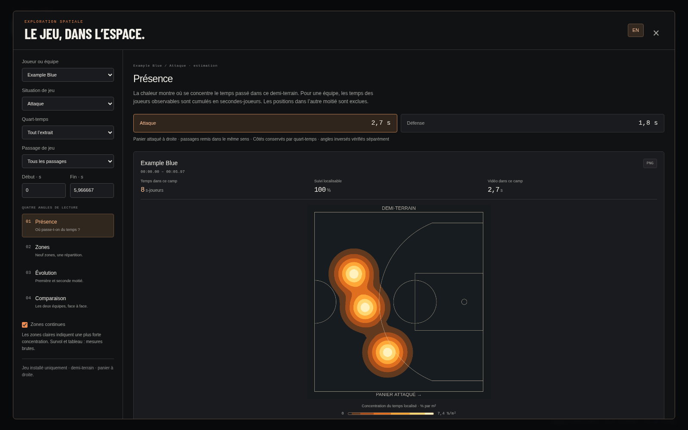
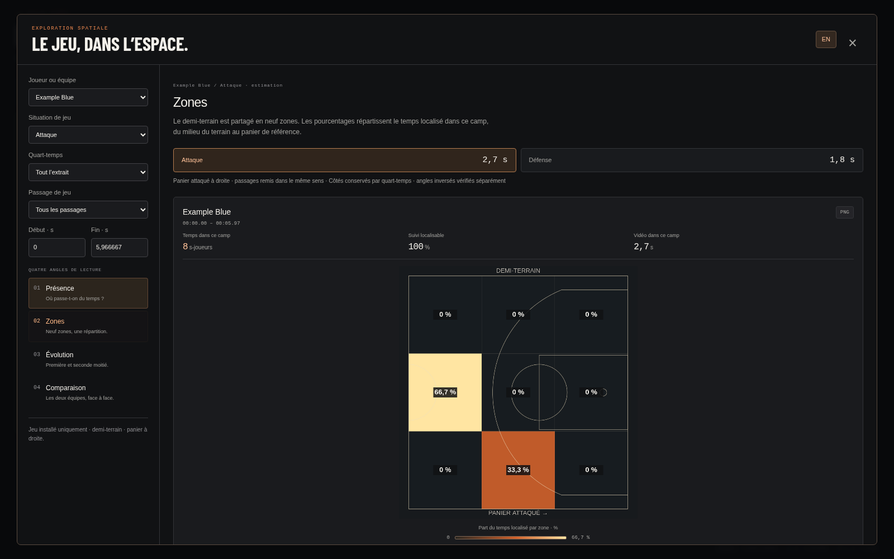
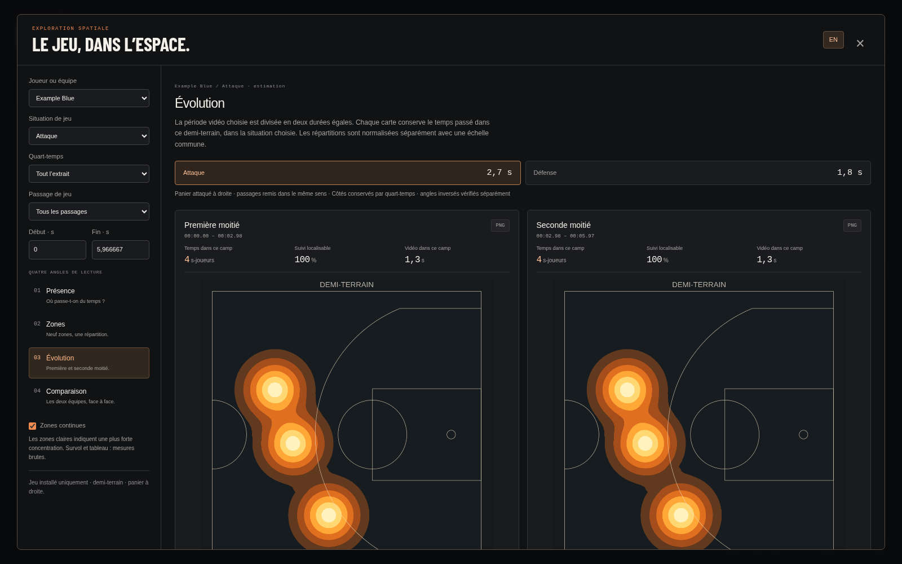
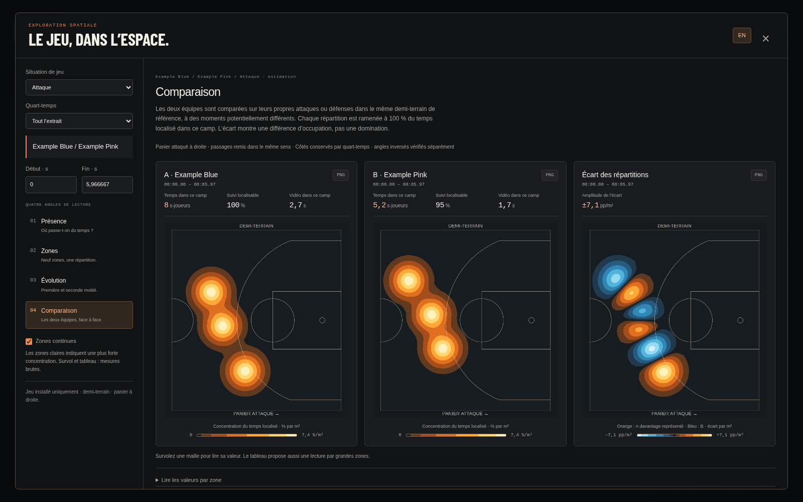

# Heatmaps en demi-terrain — revue du 26 octobre 2026

Le viewer conserve **Présence, Zones et Évolution** pour un joueur ou une équipe,
et une **Comparaison directe des deux équipes**. Déplacements et le choix d’un
adversaire ne sont plus proposés. Cette revue décrit le cadrage final de la PR #6,
qui attend une validation avant fusion.

## Cadrage et calcul

Les phases restent celles du [modèle de jeu installé](../settled-play-2026-10-26/README.md).
Le panier attaqué, ou défendu, est remis à droite. Le calcul spatial conserve
ensuite uniquement la moitié comprise entre la ligne médiane et ce panier.
Il ne replie pas les positions de l’autre camp dans la carte.

Un court trajet franchissant la médiane est découpé exactement au franchissement :
seule sa durée dans la moitié affichée contribue. La grille métrique, les neuf
zones et le dénominateur des pourcentages utilisent tous ce même périmètre.
Les cartes NBA représentent **14,3256 × 15,24 m**, avec une seule raquette, le panier,
les trois points et le demi-cercle central à gauche. Le rendu continu et les PNG
respectent ces proportions et conservent les contributions aux bords.

Le temps localisé dans l’autre moitié est indiqué séparément lorsqu’il existe.
Il est exclu des cartes, mais reste valide pour le taux de localisation : le
recadrage ne doit pas être présenté comme une mauvaise calibration. La durée de
vidéo documentée sous chaque carte concerne désormais le demi-terrain affiché.

## Lecture des quatre vues

| Vue | Intérêt |
| --- | --- |
| Présence | Repérer où un joueur passe du temps, ou comment l’occupation collective se répartit dans le camp étudié. |
| Zones | Lire cette occupation sur neuf secteurs géométriques, du milieu du terrain au panier. |
| Évolution | Comparer deux moitiés égales de la plage vidéo choisie, en retenant la même situation et le même demi-terrain. Chaque moitié est normalisée séparément avec une échelle commune. |
| Comparaison | Confronter les deux équipes sur leurs propres attaques ou défenses, puis lire leur écart spatial. Chaque profil est normalisé séparément ; ce n’est pas une mesure de domination. |

La comparaison n’affiche aucun sélecteur de joueur ou d’adversaire. Les équipes
sont celles du roster du run, dans un ordre stable. Les filtres Attaque/Défense,
quart-temps et bornes vidéo restent disponibles. Un passage individuel actif est
retiré à l’entrée de la comparaison, qui revient à la plage du quart-temps choisi ;
une plage manuelle sans passage reste conservée. Le contexte joueur est mémorisé
pour revenir aux autres vues. Les passages vidéo à revoir identifient l’équipe.

Une plage ne comportant des attaques que pour une seule équipe laisse la carte
adverse vide et ne produit pas de différence artificielle. Les temps observables
et leurs couvertures restent visibles pour chaque équipe.

## Vérifications

- **442 tests Python réussis, 28 optionnels ignorés**, soit 470 découverts ;
  **30 tests JavaScript réussis**. Résultat global : `passed`.
- Cas numériques : exclusion de l’autre moitié, franchissement dans les deux sens,
  fenêtre temporelle partielle, rotation de caméra, défense, frontière médiane,
  carte vide, évolution et conservation de la masse après reconstruction continue.
- Comparaison limitée aux deux équipes dans l’API ; sélection automatique,
  conservation du joueur et du quart-temps, retrait du passage individuel dans le navigateur.
- Chromium : les quatre vues, joueur/équipe pour les trois vues individuelles,
  Attaque/Défense, FR/EN, tableaux, PNG aux proportions du demi-terrain,
  données absentes, réponses tardives et axe-core. Lecteur sur huit tailles ;
  fenêtres Présence et Comparaison sur six tailles, de 1920 × 1080 à 390 × 844.
- Image Docker construite et contrôlée en lecture seule : vidéo et comparaison
  automatique en attaque et en défense, avec conservation des totaux.
- Démo publique vérifiée ; lecture locale de HOU–LAL contrôlée sur les quatre vues.

Sur HOU–LAL, le recadrage donne **18,00 s-joueurs** pour Houston en attaque,
avec **0,17 s-joueurs** localisées dans l’autre moitié puis exclues ; les Lakers
comptent **46,03 s-joueurs** dans leurs propres attaques. Ce sont des cumuls des
joueurs observables, pas des durées de possession. Le découpage des phases reste
inchangé à 32,00 s de jeu installé. Ces valeurs contrôlent l’intégration sur cet
extrait ; elles ne valident pas indépendamment la calibration ou le classifieur.

La qualité reste dépendante des détections, identités, phases et projections.
Les joueurs hors champ ne sont pas reconstruits et les ralentis ne sont pas
exclus automatiquement. Aucun entraînement, modification d’annotation ou de
vidéo NBA, ni nouvelle dépendance de production.

## Aperçus publics

Captures du sample **synthétique et scripté** uniquement, sans image NBA ni mesure
de précision des modèles. Les captures du vrai extrait restent locales.

