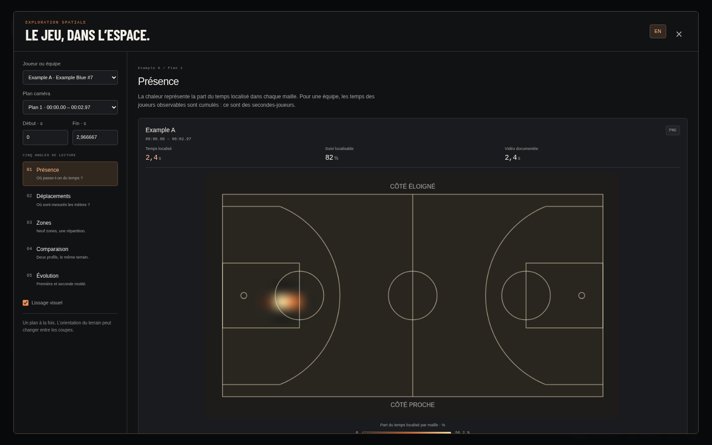
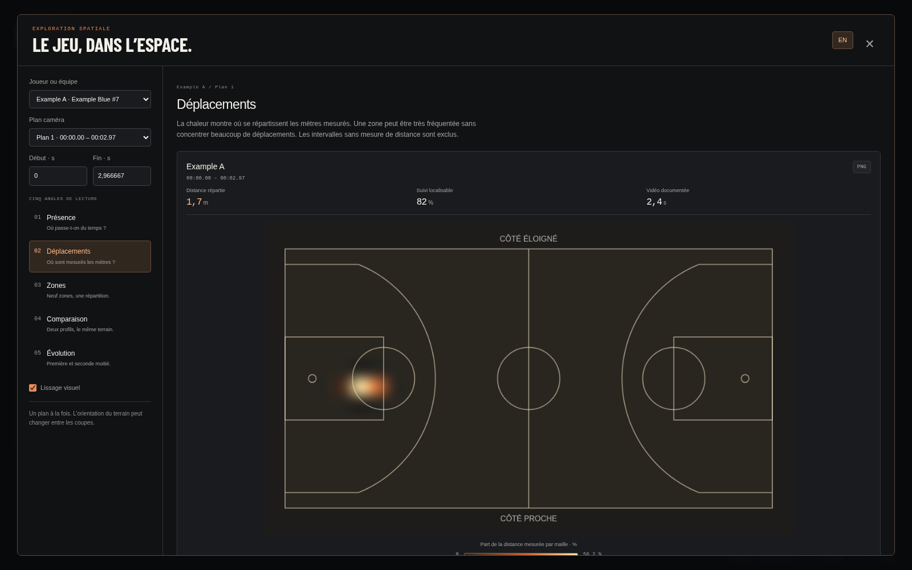
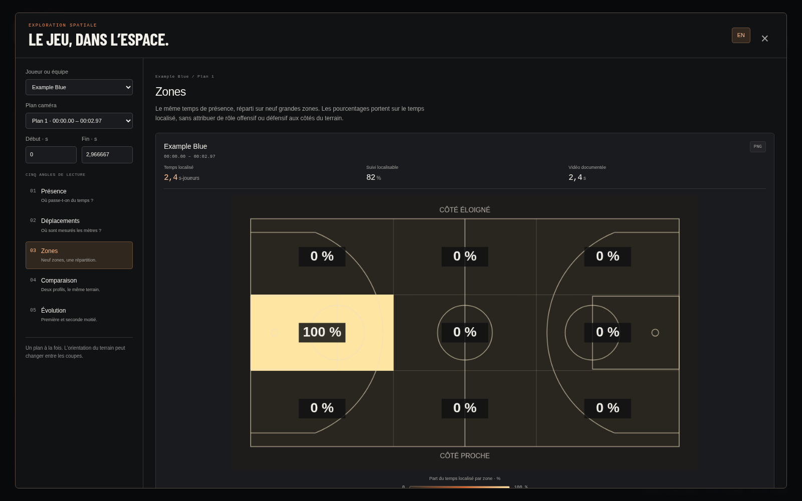
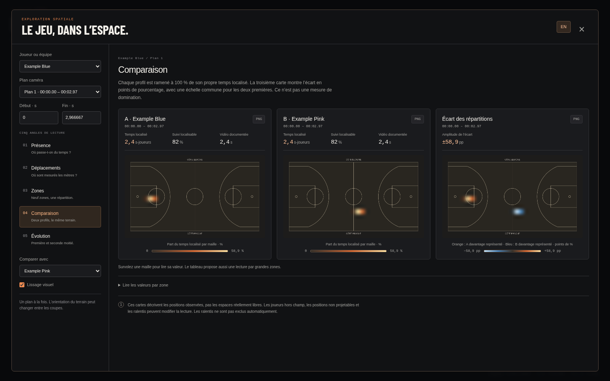
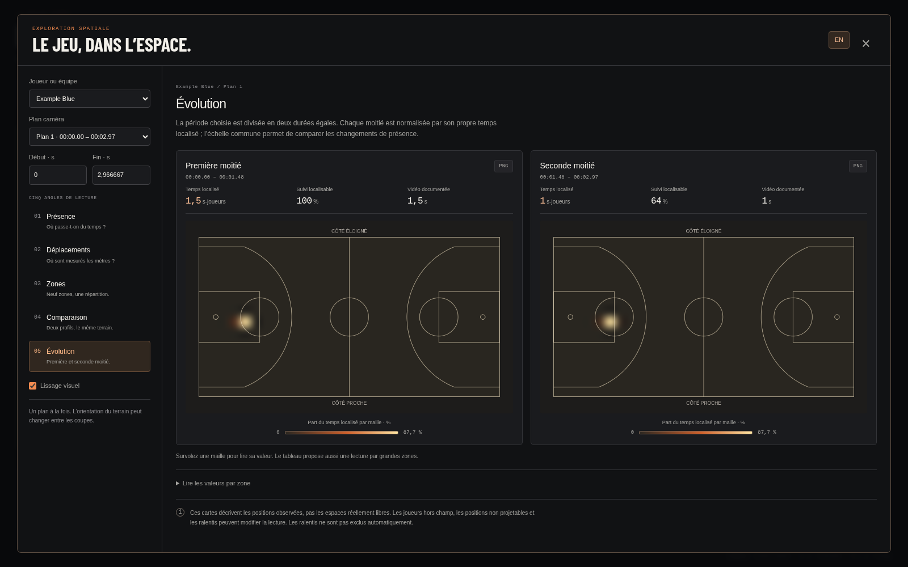

# Heatmaps — propositions à examiner, 26 octobre 2026

Cinq angles sont implémentés dans le viewer, pour **un joueur ou une équipe**.
Le but est de les essayer sur les mêmes données avant de choisir lesquels garder.
La validation visuelle et la sélection d’Erwan restent attendues avant tout merge.

Le bouton **Heatmaps** du terrain ouvre une fenêtre agrandie. Les fiches joueur
et équipe proposent un accès direct. La vidéo est mise en pause ; les calques et
la sélection du lecteur sont conservés. Les contrôles et explications existent
en français et en anglais.

## Angles proposés

| Angle | Intérêt individuel | Intérêt collectif | Limite de lecture |
| --- | --- | --- | --- |
| **Présence** | Identifier les zones où le joueur passe son temps observable. | Lire la répartition spatiale cumulée des joueurs attribués à l’équipe. | Le hors-champ n’est pas observé. Une zone sombre n’est pas forcément libre. |
| **Déplacements** | Voir où se concentrent les mètres parcourus mesurés. | Distinguer les zones de circulation de celles où les joueurs restent. | Ce n’est ni une vitesse ni une intensité physique ; seules les contributions valides du pipeline sont utilisées. |
| **Zones** | Résumer le profil sur neuf grandes zones avec des pourcentages. | Rendre la répartition collective immédiatement chiffrable. | La grille 3 × 3 est géométrique ; elle ne prétend pas identifier corners, raquette ou phases tactiques. |
| **Comparaison** | Comparer deux profils individuels sur la même période. | Comparer les répartitions des deux équipes avec une troisième carte d’écart. | Chaque profil totalise 100 % de son propre temps localisé. L’écart n’indique pas une domination. Les couvertures peuvent différer. |
| **Évolution** | Repérer un changement de positionnement entre deux moitiés temporelles. | Voir une variation collective dans un même plan. | Les fenêtres sont courtes et chaque moitié possède son propre volume de données et sa propre couverture. |

La comparaison utilise une échelle commune pour A et B, puis une échelle divergente
symétrique pour leur différence en points de pourcentage. Sans observations
localisables pour A ou B, la différence reste indisponible. L’évolution divise
la période en deux durées égales et partage une échelle entre les deux cartes.

## Calcul et fiabilité

- Intervalles pondérés par leur durée réelle, grille d’environ un mètre, découpage
  temporel proportionnel et conservation des secondes ou mètres distribués.
- Temps individuel en secondes ; temps collectif en **secondes-joueurs**.
  La durée de vidéo documentée est l’union des intervalles localisables,
  pas leur somme. Aucun suivi complet des cinq joueurs n’est supposé.
- Couverture = temps localisé / suivi attribué. Elle ne mesure ni les joueurs
  hors champ ni la justesse de la calibration. Les contributions de déplacement
  ont en plus leur propre couverture de mesure.
- Pas de liaison entre plans, identités différentes, frames absentes, périodes
  exclues, changements de méthode de point au sol ou sauts de vitesse invalides.
  Aucun intervalle n’est ajouté après la dernière image.
- Plans séparés pour conserver leur orientation locale. Aucun sens d’attaque,
  événement, possession ou position métrique du ballon n’est inventé.
- Lissage d’affichage facultatif ; survol et tableaux lisent les valeurs brutes.
  Les PNG emportent la période, la légende, les limites et les informations
  nécessaires pour identifier le sujet ou les deux profils comparés.
- Effectif réel du run et géométrie métrique explicite requis. L’effectif indicatif
  du lecteur ne suffit pas. Les ralentis ne sont pas exclus automatiquement.

Les dimensions de terrain ont été ajoutées au manifeste du **sample scripté**,
à partir des dimensions déjà utilisées par son générateur. Ses observations,
sa vidéo et ses statistiques n’ont pas été modifiées. Les anciens runs sans
cette déclaration affichent une explication au lieu de supposer une géométrie.
Le calcul reste local, en lecture seule, sans dépendance ML supplémentaire.

Le [guide du viewer](../../viewer/README.md#heatmaps--cinq-angles-à-comparer)
détaille les dénominateurs, les contrôles et les conditions de validité.

## Aperçus publics

Toutes les images ci-dessous proviennent du **sample synthétique et scripté**.
Elles illustrent l’interface et ne valident pas la précision d’un modèle.
Le sample ne contient qu’un joueur par équipe : les cartes équipe et joueur
peuvent donc avoir la même répartition.

### Présence individuelle

### Déplacements individuels

### Répartition collective par zone

### Comparaison des équipes

### Évolution collective

La revue locale a également utilisé les observations HOU–LAL existantes, sans
relancer l’inférence. Les captures correspondantes restent dans le dossier ignoré
`release/heatmap-review/` ; aucune vidéo NBA n’est publiée dans cette PR.
Sur le premier plan (0–13,27 s), Houston dispose de 27,9 secondes-joueurs localisées,
soit 49 % de son suivi attribué ; les Lakers de 41,1 secondes-joueurs, soit 69 %.
Ces écarts rendent nécessaire l’affichage de la couverture à côté des cartes.
Ils ne constituent pas une validation de précision métrique.

## Validation

- Suites Python hors ligne : **390 réussis, 28 optionnels ignorés** sur 418 tests
  découverts. Parmi eux, 13 vérifications analytiques des heatmaps et trois
  nouveaux scénarios HTTP. Résultats : `runs/checks/heatmaps-2026-10-26/`.
- **21 tests JavaScript** réussis ; syntaxe de `app.js`, `i18n.js`, `heatmaps.js`.
- Chromium sur le sample : cinq modes pour les deux types de sujet ; conservation
  des totaux grille/zones, découpage temporel, changement de plan, FR/EN sans
  perte des filtres, export PNG, fermeture au clavier et retour du focus.
- Cas incomplets et concurrence : métadonnées sans géométrie, profil B sans
  données et réponse tardive après un changement de mode.
- Résolutions du lecteur : 1920 × 1080, 1600 × 1000, 1440 × 900, 1366 × 768,
  1280 × 720, 1024 × 768, 820 × 900 et 390 × 844. La fenêtre de heatmaps est
  également vérifiée sur six de ces tailles, sans débordement horizontal.
- axe-core : aucune violation automatique WCAG 2 A/AA et 2.1 AA sur les cinq modes,
  les états incomplets et les vues existantes du lecteur. Ce contrôle n’équivaut
  pas à un audit manuel complet ni à une certification de tous les navigateurs.
- Image Docker construite et suites navigateur exécutées contre le conteneur
  en lecture seule. Les nouveaux modules sont inclus sans dépendance Python
  supplémentaire. GitHub Actions rejoue les contrôles et archive les captures.

Aucune modification des poids, des annotations ou de l’inférence. Aucun merge
n’est autorisé par cette livraison : les cinq variantes sont proposées à la revue.
