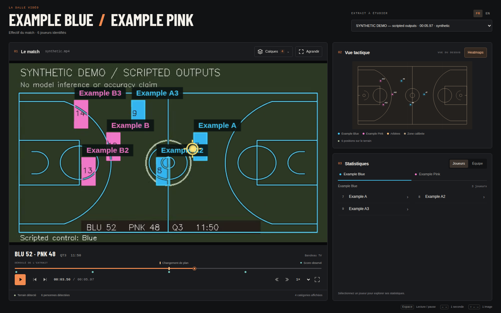
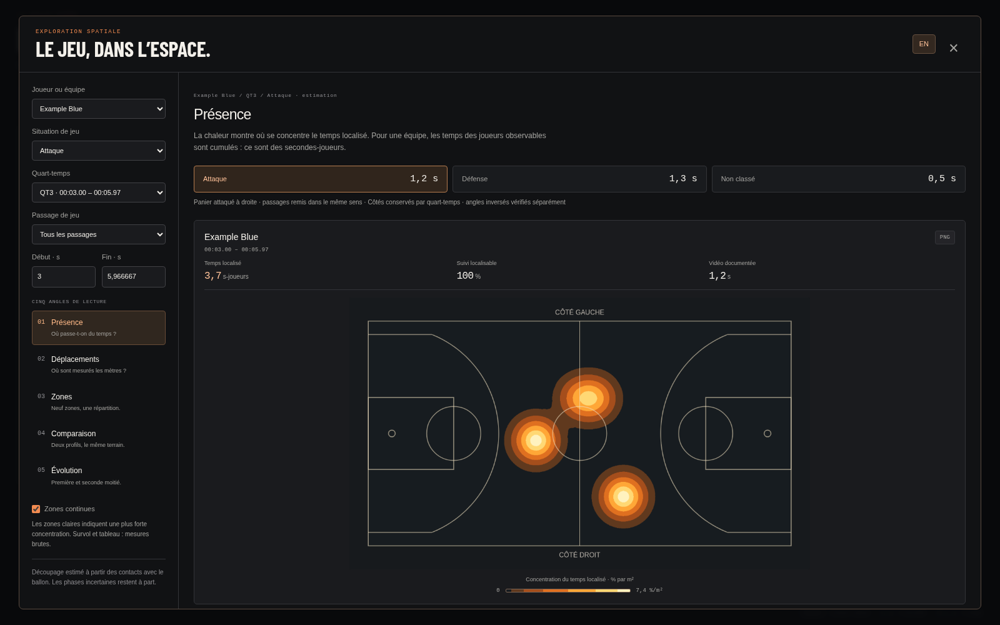

# Quart-temps, sens d’attaque et score dans la timeline

Le viewer lit maintenant un bandeau NBA préparé hors lecture : **score, QT,
chronomètre**, puis repères de score cliquables. Les heatmaps proposent une
**plage par quart-temps** avant de choisir un passage d’attaque ou de défense.
La PR reste ouverte pour revue ; aucun merge n’est effectué.





Ces captures publiées utilisent exclusivement le scénario public synthétique,
avec une coupe QT1 → QT3. Les captures et recadrages du match NBA restent locaux.
Les libellés du bandeau de démo sont scriptés ; ils ne constituent pas un test OCR.

## Pourquoi ces choix

- **Côtés stables sur le QT** : le premier plan avec 0,75 s d’indices et 80 %
  d’accord fixe le repère du quart-temps. Les plans suivants le réutilisent.
  Un angle inversé demande 0,75 s et 90 % d’accord pour être traité séparément ;
  une contradiction importante non résolue écarte l’orientation. Un faible indice
  contraire ne retourne plus le repère de tout le QT.
- **Score dans la timeline** : retrouver les périodes où le score évolue sans
  ajouter de panneau au viewer. Le score lu s’affiche au point de lecture ; les
  points turquoise renvoient aux mises à jour observées. Le temps source et le
  chronomètre du match sont affichés séparément.
- **Plage du quart-temps dans les heatmaps** : comparer présence, déplacements,
  zones, profils et évolution sur une période de jeu compréhensible. Les bornes
  restent modifiables dans cette plage, sans inclure le QT suivant.

Le sens des paniers reste indépendant du contrôle de balle. Le verrouillage ne
remplit pas artificiellement les phases sans possession attribuable. Les cartes
continuent à présenter le panier de référence à droite.

En NBA, les équipes changent de panier **à la mi-temps**, et les prolongations
conservent le sens de la seconde mi-temps
([règle NBA 4, section I](https://official.nba.com/rule-no-4-definitions/)).
Le viewer ne retourne donc pas automatiquement les côtés à chaque nouveau QT.
Chaque période doit fournir son propre repère ; sans QT confirmé, le repli est
l’estimation locale par plan.

## Expérience de développement sur HOU–LAL

Même vidéo et observations que l’[expérience précédente](../attack-defense-2026-10-26/README.md),
source SHA256 `e841e7d9c584884d8db0dc7202795f590560f3de159c5a104e01ebadeadde8b9`,
61,37 s analysées. Le profil fixe **ESPN playoffs bas d’écran**, étalonné en
1920×1080, vérifie les noms **HOU / LAL** avant d’attribuer les deux scores.
La position est constante pour cet habillage ; cela ne généralise pas à tous
les diffuseurs NBA. Les rectangles se mettent à l’échelle de la résolution.

L’OCR est effectué à **2 Hz**, dans six petites régions. Le QT et le score doivent
être confirmés par deux lectures voisines concordantes. Le score peut rester
inconnu alors que le QT et le chronomètre sont lisibles. Les logos animés, lectures
incohérentes et longs trous ne sont pas remplis. Une lecture est conservée au plus
0,755 s avec cet échantillonnage, sans extrapoler le chronomètre.

| Mesure | Résultat |
| --- | --- |
| Images échantillonnées | 123 |
| QT confirmé | 123 / 123 |
| Chronomètre confirmé | 123 / 123 |
| Score complet confirmé | 108 / 123 |
| Points manuels de développement, toutes les 3 s | 21 |
| QT et chronomètre sur ces points | 21 conformes chacun, aucune erreur observée |
| Scores sur ces points | 18 conformes, 1 indisponible, aucune erreur observée |
| Points où le logo remplace le score | 2, tous deux laissés indisponibles |

Les [points manuels](review-checkpoints.json) et le [résultat reproductible](experiment.json)
sont liés au hash source. Ils ont servi au développement du recadrage et des
prétraitements : **ce n’est pas un échantillon indépendant de validation**, ni une
mesure de précision applicable à tous les matchs. Le chronomètre conserve la
valeur de l’image échantillonnée, pas une synchronisation image par image.

Le premier repère du QT1 contient 1,3 s d’indices concordants : **Houston vers la
gauche, Lakers vers la droite**. Les autres plans de jeu réutilisent ce repère.
Le contrôle de balle est inchangé : **34,8 s classées**, dont **22,2 s d’attaque
Houston et 12,6 s de défense**, et **26,57 s non classées**. Le verrouillage améliore
la stabilité du sens ; il ne revendique pas de gain de couverture de possession
sur cet extrait. Les 34,8 s classées disposaient déjà d’une orientation exploitable.

Le montage comporte des sauts de chronomètre. Une différence de score ne devient
ni une tentative détectée, ni un nombre officiel de possessions, ni un panier
horodaté. Les baisses de score et retours à un QT précédent nécessitent une revue ;
les ralentis du même QT et corrections de score ne sont pas reconnus automatiquement.

## Reproduire

Tesseract avec `eng` doit être installé et accessible, et OpenCV disponible dans
l’environnement de préparation. Le viewer et son conteneur restent en bibliothèque
standard, sans nouvelle dépendance ML au runtime.

```bash
.venv-players/bin/python -m viewer.scoreboard_extract \
  --run runs/analysis/hou-lal-sam-yolo26l-ball \
  --left-team houston_rockets:HOU \
  --right-team los_angeles_lakers:LAL \
  --review-checkpoints reports/quarter-score-2026-10-26/review-checkpoints.json \
  --report /tmp/quarter-score-experiment.json
```

Cette commande ajoute/remplace uniquement `scoreboard.json` dans le run, avec
hash vidéo, profil, moteur OCR, lectures brutes et lectures confirmées. Le viewer
invalide son cache si ce dérivé change. Une vidéo ou des équipes non concordantes
rendent le dérivé inutilisable. Les observations, annotations et poids existants
restent inchangés. Voir aussi le [guide du viewer](../../viewer/README.md).

## Validation

Les tests couvrent la confirmation temporelle, champs manquants, source/équipes,
scores inversés, absence d’anticipation du score, données périmées, frontières de
QT sans chevauchement, réutilisation du sens, indices opposés faibles, angle caméra
inversé confirmé, QT1/QT2 identiques et QT3/QT4 inversés, ainsi que le repli sans QT.
Chromium vérifie les repères cliquables, plages QT1/QT3, FR/EN et anciens runs.
Le reste de la validation est détaillé dans la PR.

Vérification locale : **422 tests Python réussis, 28 optionnels ignorés**
(450 découverts), **28 tests JavaScript réussis**. Les tests navigateur du lecteur
passent sur huit résolutions, ceux des heatmaps sur six tailles avec axe-core,
puis les tests score/QT passent aussi contre l’image Docker en lecture seule.
