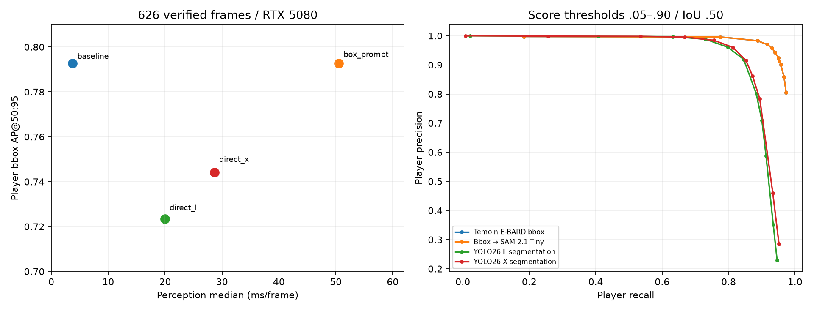

# Segmentation : comparaison des deux stratégies — 25 octobre 2026

**Décision proposée : conserver la détection bbox actuelle pour le pipeline courant.**
Les deux stratégies sont développées et exécutables dans une branche séparée,
sans promotion ni changement du profil courant. Parmi les modèles directs,
**X est le meilleur candidat à poursuivre si la priorité est la fiabilité des
détections**, L si le coût de perception prime. Aucun gain de précision OCR
n'est démontré par cette expérience.

Les mesures ci-dessous correspondent aux sources du commit `5632ff6`. Les ajouts
ultérieurs du studio et de l’adaptateur balle YOLO sont évalués dans leurs propres
runs ; ils ne modifient pas les prédictions archivées de cette comparaison.

## Ce qui a été testé

| Configuration | Joueurs | Arbitres | Entrée OCR comparée |
| --- | --- | --- | --- |
| Témoin | E-BARD YOLOv8n bbox | E-BARD bbox | Crop initial |
| Hypothèse 1 | E-BARD bbox → SAM 2.1 Tiny | E-BARD bbox → SAM 2.1 Tiny | Crop initial / fond neutralisé par masque |
| Hypothèse 2, L | YOLO26 L segmentation COCO | E-BARD bbox uniquement | Crop initial / fond neutralisé par masque |
| Hypothèse 2, X | YOLO26 X segmentation COCO | E-BARD bbox uniquement | Crop initial / fond neutralisé par masque |

**Aucun fine-tuning.** Le chemin direct ne lance aucune détection joueur avant
la segmentation. Ses boîtes d'instances alimentent le suivi et la pose. Le
checkpoint COCO reconnaît des personnes ; les personnes non associées aux
arbitres sont explicitement traitées comme un **proxy de joueur**. Les personnes
du banc, spectateurs et arbitres manqués ne sont pas automatiquement exclus.
Ce défaut fait partie du résultat ; les annotations ne filtrent jamais les
prédictions.

SAM reçoit toutes les boîtes d'une frame comme prompts et encode la frame une
fois. Les masques sont limités à la ROI de leur boîte ; les boîtes, scores et
rôles du détecteur restent identiques. Cette conservation a été vérifiée sur les
**626 frames**, pas seulement sur les scores agrégés.

## Données et protocole

**626 frames vérifiées, 5 844 annotations joueur et 1 534 annotations arbitre.**
Les annotations train sont utilisées comme demandé : les segmentateurs n'ont
pas été entraînés ou fine-tunés sur ces vidéos dans cette expérience.

| Split local / vidéo déclarée | Frames | Joueurs annotés | Intervalle source |
| --- | ---: | ---: | --- |
| train / HOU–LAL G1 | 113 | 1 029 | frames 0–1830 ; généralement une frame sur 15 |
| train / MIN–DEN G3 | 112 | 1 056 | frames 0–1800 ; généralement une frame sur 15 |
| val / PHX–OKC G4 | 201 | 1 793 | frames 0–200 consécutives |
| val / POR–SAS G5 | 200 | 1 966 | frames 0–199 consécutives |

Quatre autres vidéos train n'ont aucune frame vérifiée et sont exclues. Les
frames proposées ne sont pas transformées en vérité terrain. Les annotations
source sont inchangées ; l'export de travail est distinct.

Les annotations train ont été **préproposées par E-BARD puis vérifiées**. Les
propositions val venaient de `Joueurs_26X`. La géométrie peut donc favoriser le
modèle proposant les boîtes, surtout sur train. Le score global pondère les
observations ; ce n'est pas une moyenne de quatre matchs indépendants. Les
frames val sont fortement corrélées, sur environ 6–7 secondes par vidéo.
Aucun intervalle de confiance fondé sur l'indépendance des frames n'est annoncé.
L'absence de fine-tuning local ne prouve pas l'absence de chevauchement avec
les données utilisées en amont par les modèles préentraînés.

Le [protocole figé](protocol.json) précède l'inférence et inclut les empreintes
du code, des checkpoints, des données et des sous-échantillons. RTX 5080,
FP32, batch 1 ; E-BARD et YOLO à `imgsz=640`, SAM à 1024. Prétraitement natif
rectangulaire pour YOLO. AP bbox calculée avec un passage à score ≥ 0,001 ;
précision/rappel/F1 avec le véritable appel à score ≥ 0,25 et IoU ≥ 0,50.
Le témoin utilise le modèle et l’adaptateur actuels à 640 pour cette comparaison ;
le profil principal `analysis.yaml` reste à 704. Ces chiffres ne remplacent donc
pas un benchmark de ce profil complet.
Appariement un-à-un, score décroissant. **Les AP ci-dessous sont des AP de
boîtes, pas des AP de masques.**

## Les détections sont-elles bonnes ?

Sur l'ensemble des annotations vérifiées :

| Configuration | AP bbox @50:95 | Précision joueur | Rappel joueur | F1 joueur | Faux positifs | Joueurs manqués |
| --- | ---: | ---: | ---: | ---: | ---: | ---: |
| Témoin E-BARD | 0,7926 | 91,21 % | 95,29 % | 93,21 % | 537 | 275 |
| Bbox → SAM | 0,7926 | 91,21 % | 95,29 % | 93,21 % | 537 | 275 |
| YOLO26 L segmentation | 0,7235 | 70,93 % | 90,02 % | 79,35 % | 2 156 | 583 |
| YOLO26 X segmentation | 0,7442 | 86,13 % | 87,25 % | 86,69 % | 821 | 745 |

**X produit 1 335 faux positifs de moins que L**, mais manque 162 observations
joueur supplémentaires. Comparé au témoin, X ajoute 284 faux positifs et 470
joueurs manqués. Ces quantités comptent des observations de frames, pas des
personnes distinctes ni des erreurs d'identité.

La validation seule donne une lecture différente de la précision de localisation :

| Configuration | AP bbox @50:95, val | Précision, val | Rappel, val | F1, val |
| --- | ---: | ---: | ---: | ---: |
| Témoin / bbox → SAM | 0,7296 | 90,14 % | 95,13 % | 92,57 % |
| L segmentation | 0,7325 | 71,08 % | 89,62 % | 79,28 % |
| X segmentation | **0,7617** | 83,75 % | 86,65 % | 85,17 % |

**X localise donc mieux les boîtes selon l'AP val**, sans offrir le meilleur
couple précision/rappel au seuil fixé. On ne peut conclure « X est moins bon
partout » à partir de l'AP globale influencée par train. Les résultats par vidéo,
par rôle et par split sont disponibles dans [detection.csv](detection.csv) et
[results.json](results.json).

Le simple réglage du seuil ne fait pas disparaître l'écart de F1 sur ces données.
Le balayage diagnostique de 0,05 à 0,90 atteint un meilleur F1 global de 0,9439
pour E-BARD à 0,50, 0,8807 pour L à 0,40 et 0,8825 pour X à 0,30. Ce sont des
maxima **choisis après observation des mêmes données**, pas de nouveaux seuils
validés pour la production. Voir les [courbes de seuil](threshold-curves.json).
Les scores des familles ne sont pas calibrés comme des probabilités comparables.
Sur val seule, les meilleurs F1 de ce même balayage sont 0,9380 (E-BARD),
0,8756 (L) et 0,8769 (X) : le constat ne dépend donc pas seulement de train.
Les détails sont dans [split-threshold-curves.json](split-threshold-curves.json).

Sur les 2 156 faux positifs L, 1 943 n'ont même pas un IoU de 0,10 avec un joueur
annoté et ne recouvrent pas un arbitre annoté à IoU ≥ 0,50 ; X en compte 722 sur
821. Cela oriente la revue vers les instances supplémentaires plutôt que vers
un simple décalage des contours. Les catégories géométriques sont dans
[verification.json](verification.json) ; elles ne prétendent pas identifier
sémantiquement chaque spectateur. Les exemples visuels montrent notamment des
personnes en bord de terrain et dans le public considérées comme joueurs.

Les arbitres restent comparables : mêmes poids et **mêmes métriques bbox** pour
les quatre configurations (précision 94,04 %, rappel 95,63 %, F1 94,83 %). SAM
produit 1 560 masques d'observations arbitre ; le chemin direct n'en produit aucun,
comme demandé. Aucune précision de masque arbitre n'est mesurée sans gold masque.

## Coût de perception

Mesure sur 65 frames présélectionnées, réparties entre les quatre vidéos,
5 appels de chauffe puis 3 répétitions, soit **195 mesures par configuration**.
Chaque configuration utilise un processus neuf. CUDA est synchronisé autour de
l'appel. L'intervalle couvre l'image BGR déjà décodée jusqu'aux boîtes et masques
RLE disponibles sur CPU ; il exclut le disque, la pose, le suivi et l'OCR.

| Configuration | Médiane / P95, ms | Pic CUDA alloué / réservé, Mio |
| --- | ---: | ---: |
| Témoin | 3,75 / 4,15 | 32 / 172 |
| Bbox → SAM | 50,53 / 54,53 | 824 / 2 042 |
| L segmentation | 19,95 / 28,48 | 591 / 1 216 |
| X segmentation | 28,68 / 29,99 | 579 / 1 068 |

SAM ajoute environ **46,8 ms/frame** au témoin et dépasse déjà le budget de
33,3 ms d'une vidéo à 30 FPS pour cette seule étape. X ajoute environ 8,7 ms par
rapport à L. Le pic mémoire ne se déduit pas de la taille du modèle : nombre de
personnes, masques et opérations intermédiaires diffèrent. Ces pics PyTorch
excluent les contextes CUDA et les allocations ONNX Runtime. Ils ne sont pas des
plafonds de mémoire du pipeline complet.

Les FPS de perception ne sont pas des FPS vidéo de bout en bout. Les essais sur
séquences avec suivi, pose et OCR sont consignés séparément dans la section de
validation et leur artefact de comparaison.

## Effet sur les numéros de maillot

Une frame vérifiée sur quinze par source est retenue avant inférence :
**44 frames, 414 annotations joueur**. Pour chaque prédiction joueur, même pose,
même cadrage du torse, mêmes filtres de qualité, puis deux lectures PARSeq : crop
initial et crop dont le fond hors masque est mis à 127. Netteté/contraste sont
mesurés avant masquage. En cas de masque absent ou couvrant moins de 50 % du
crop, la politique expérimentale garde le crop initial et journalise le repli.

| Configuration | Crops éligibles | Masques appliqués | Lectures acceptées brutes / masquées | Dont lectures sur prédictions sans appariement joueur |
| --- | ---: | ---: | ---: | ---: |
| Témoin | 259 | 0 | 3 / 3 | 0 |
| Bbox → SAM | 259 | 258 | 3 / 3 | 0 |
| L segmentation | 260 | 258 | 5 / 5 | **2** |
| X segmentation | 254 | 252 | 3 / 3 | 0 |

Aucun numéro ne change lorsque les deux versions d'un crop sont acceptées.
**Les deux lectures supplémentaires de L proviennent de détections non
appariées aux joueurs annotés.** Compter cinq lectures plutôt que trois aurait
donc donné une impression de progrès trompeuse. Voir
[ocr-matched-support.json](ocr-matched-support.json).

Ces lectures sont acceptées par le décodeur (EOS, un/deux chiffres ASCII,
confiance ≥ 0,90), sans filtre d'effectif pour cette ablation. Elles ne sont
pas toutes démontrées correctes. Le faible nombre de lectures interdit de
conclure à l'équivalence des méthodes OCR ou à l'absence de tout bénéfice du
masque. Cette ablation conserve le cadrage et le filtre de chevauchement
existants ; elle ne teste pas un nouveau cadrage ou une sélection de crops
conçus spécialement autour des masques.

Les annotations bbox ne contiennent pas de numéro ni de masque de référence.
**Précision OCR, IoU/Dice masque et rétention des pixels des chiffres restent
`null`**, au lieu de prendre une prédiction pour vérité terrain. Le gold
historique NBA est lié à d'autres tracks : il n'est pas réutilisé par égalité
d'ID. Un gabarit de revue de 414 objets est préparé localement avec `frame_id`,
`object_id` et SHA-256 image. Le [scoreur de revue](../../training/segmentation/review.py)
mesure ensuite précision des lectures, couverture correcte, abstention,
IoU/Dice et conservation des pixels du numéro, sans exclure les détections
manquées. Le [guide](../../training/segmentation/README.md) décrit son usage.

## Vérification sur une séquence avec suivi et votes de numéro

Les quatre configurations traitent aussi les **mêmes 150 frames consécutives**
de HOU–LAL (5 secondes source), chacune dans un processus neuf. Profils séquentiels,
pose GPU, OCR CPU, même effectif, balle/terrain désactivés. Le temps de traitement
inclut le suivi, les sorties, les couleurs et la reconstruction des votes par
track. Le chargement initial est séparé.

| Configuration | Chargement / traitement, s | Débit observé, frames/s | Observations JSONL, Mo décimaux | Lectures temporelles / postpasse conservées | Tracks avec majorité de numéro |
| --- | ---: | ---: | ---: | ---: | ---: |
| Témoin | 1,42 / 24,66 | 6,08 | 3,39 | 39 / 220 | 11 |
| Bbox → SAM | 1,51 / 31,56 | 4,75 | 6,92 | 39 / 220 | 11 |
| L segmentation | 1,44 / 39,99 | 3,75 | 7,98 | 38 / 448 | 11 |
| X segmentation | 1,50 / 26,30 | 5,70 | 6,21 | 37 / 216 | 10 |

La postpasse existante lit jusqu'à trois variantes de torse puis conserve la
meilleure par tentative, avec un seuil de vote de **0,80**, distinct du seuil
0,90 de l'ablation précédente. Les comptes du tableau sont des lignes conservées,
pas le nombre total de crops évalués. Les lectures temporelles gardent leur budget
habituel ; ce budget ne limite pas cette postpasse.

**SAM conserve les mêmes boîtes, rôles, scores, IDs de suivi et majorités de
numéro que le témoin sur cette séquence.** Il ajoute environ 6,9 secondes de
traitement et double presque la taille des observations. L génère davantage
d'observations et de tentatives dans la postpasse : son débit est ici inférieur
à X malgré une perception seule plus rapide. Cet effet est utile pour choisir
sur le coût aval plutôt que sur la seule taille du modèle.

Les nombres de majorités ne sont pas des scores de justesse. Une personne peut
être fragmentée en plusieurs tracks ou épisodes ; les IDs des modèles directs
ne se comparent pas par leur valeur numérique. Sans trajectoires/numéros gold
alignés, aucune précision d'identité n'est annoncée. Ce court essai unique ne
mesure ni le pipeline complet avec balle/terrain, ni le débit d'un match entier,
ni une cadence garantie. Les détails, empreintes et compteurs par décodeur sont
dans [video-comparison.json](video-comparison.json).

## Choix conseillé et critères de décision

1. **Pour le pipeline actuel : garder E-BARD bbox.** Il offre le meilleur
   compromis observé de précision/rappel et de coût. Aucun gain OCR mesuré ne
   justifie aujourd'hui les 46,8 ms supplémentaires de SAM.
2. **Si l'on poursuit la segmentation directe : commencer la revue par X.**
   Son AP val et sa réduction des faux positifs en font le candidat le plus
   intéressant pour la qualité des boîtes. Il faut encore traiter le rôle
   joueur/personne et la perte de rappel. L reste l'alternative plus rapide.
3. **Si des masques joueurs et arbitres sont indispensables : l'hypothèse 1
   répond au besoin sans changer les détections.** Son surcoût est mesuré ;
   l'intérêt doit être confirmé sur une tâche aval explicitement annotée.

Avant une adoption finale fondée sur les numéros : revoir des numéros lisibles
et illisibles dans les mêmes scènes, annoter des masques et des régions de
chiffres pour contrôler leur conservation, puis mesurer les mauvaises
attributions d'identité, la couverture et le délai de confirmation sur des
trajectoires revues. Fixer ensuite le compromis précision/rappel/temps retenu
et le confirmer sur des séquences indépendantes. Aucun choix n'est promu et
la PR doit rester non fusionnée jusqu'à ta revue.

## Validation et artefacts

- **395 tests Python**, dont 367 réussis et 28 optionnels désactivés ; **7 tests
  JavaScript** et contrôle de syntaxe réussis. Les 23 nouveaux tests de
  segmentation passent aussi dans l'environnement CPU.
- Recalcul des comptes TP/FP/FN depuis les prédictions sauvegardées : identique
  aux résultats ; 626 frames par configuration ; intégrité des RLE contrôlée.
- Empreintes du code, des données et des checkpoints vérifiées avant/après
  inférence ; empreintes des huit fichiers d'annotations source inchangées.
- Trois essais réels de 30 frames avec segmentation, suivi, pose et OCR :
  masques persistés, arbitres segmentés uniquement dans l'hypothèse 1 et
  recalcul des artefacts réussi. Balle et terrain sont volontairement désactivés ;
  le statut global `partial` le signale, sans panne de capacité requise.
- ONNX Runtime a journalisé des erreurs de recherche de plan cuDNN sur certains
  lots de pose. Les appels ont terminé et les validations de sortie ont passé ;
  ce diagnostic est conservé dans les logs bruts. Aucune équivalence avec une
  pose de référence annotée n'est revendiquée.

La [décision structurée](decision.json), la [vérification](verification.json),
le [résumé des tests](checks-summary.json),
l'[audit des données](data-audit.json) et les [métriques par aire source](source-area-metrics.json)
sont versionnés. Les sorties détaillées, le gabarit de revue et les images
restent privés dans `runs/segmentation-comparison-2026-10-25-v2/`. Ouvrir
`runs/segmentation-comparison-2026-10-25-v2/review/review.html` pour huit planches
comparatives et seize exemples OCR sélectionnés. Les cas `first` sont
présélectionnés ; les cas `worst` maximisent les erreurs directes et ne décrivent
pas leur fréquence moyenne. Les métadonnées sont dans
[review-cases.json](review-cases.json) et [ocr-review-cases.json](ocr-review-cases.json).

Reproduction complète : [guide segmentation](../../training/segmentation/README.md).
Modèles : [SAM 2.1 et prompts bbox](https://docs.ultralytics.com/models/sam-2/),
[segmentation d'instances YOLO](https://docs.ultralytics.com/tasks/segment/).
