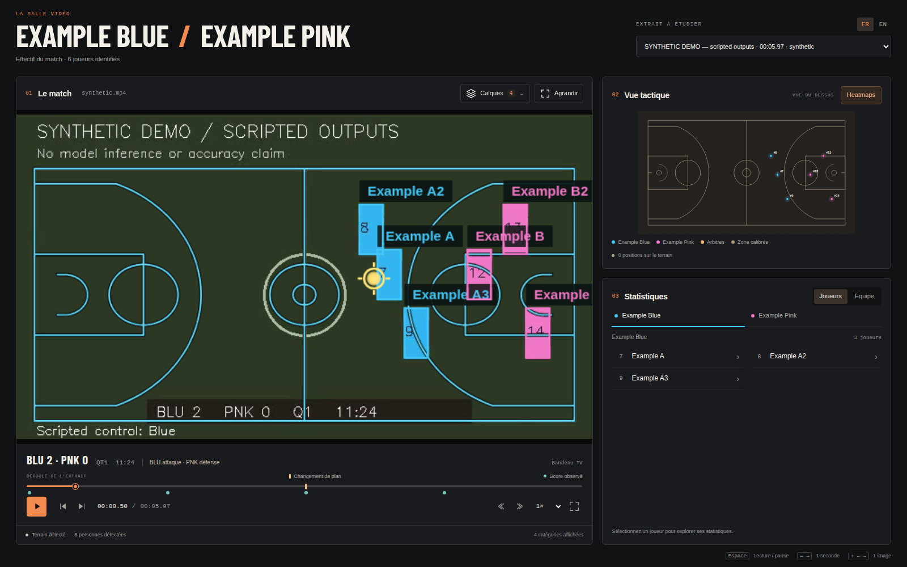
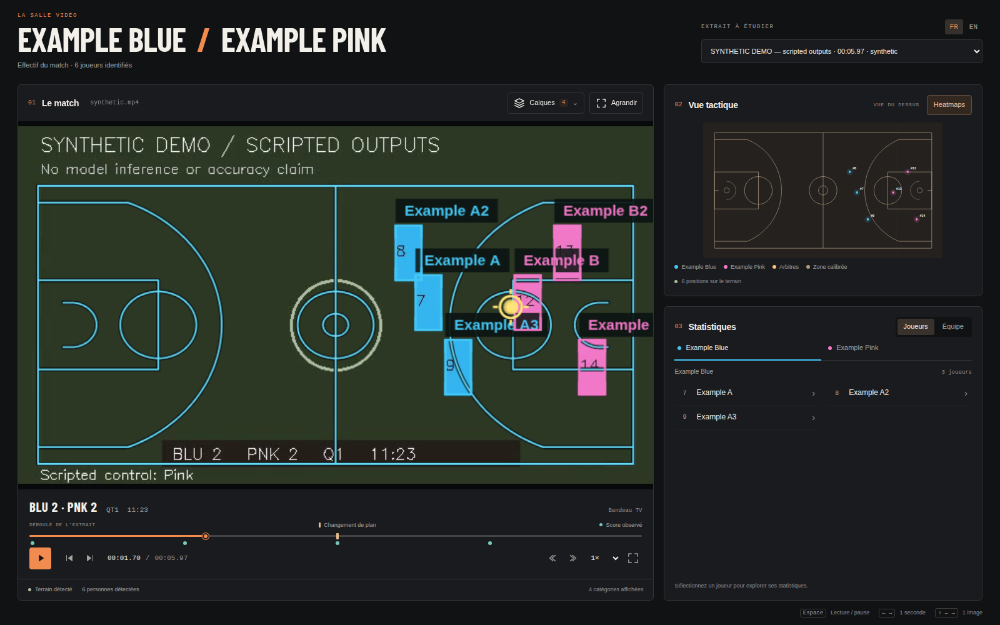
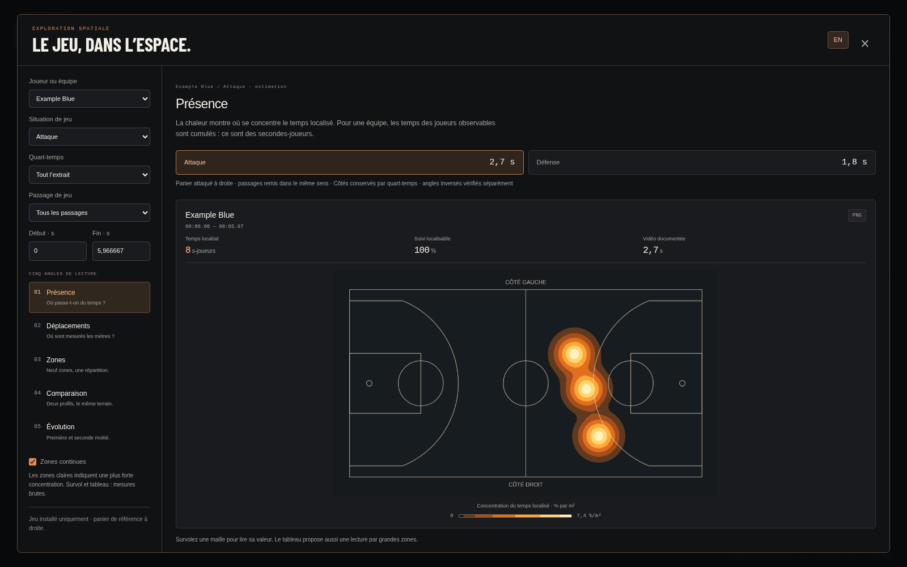

# Attaque / Défense : ne conserver que le jeu installé

Le viewer distingue désormais le **contrôle du ballon** du **jeu installé**.
Une récupération sous son propre panier n’est plus comptée comme une attaque.
Quand le changement de possession est confirmé, la phase précédente se termine ;
la nouvelle attend l’arrivée dans le camp attaqué.

Le modèle interne a trois états : attaque installée A, transition neutre,
attaque installée B. Le viewer n’en montre que deux, **Attaque** et **Défense**.
Les transitions ne figurent ni dans le sélecteur, ni dans le bilan, ni sous la
vidéo, ni dans les données retenues pour les heatmaps. La vidéo continue à jouer
normalement pendant ces intervalles.







Ces captures publiques utilisent uniquement la démo synthétique et scriptée.
Les captures NBA restent locales et ignorées par Git.

## Règle appliquée

- Les contacts et la disposition des défenseurs établissent les côtés, conservés
  sur le QT avec gestion des angles caméra inversés.
- Un contrôleur dans son demi-terrain attaqué, ou un regroupement stable dans ce
  camp, peut établir une attaque. L’équipe adverse est alors en défense.
- La disparition du ballon ne fragmente pas à elle seule une phase installée.
- Un contrôle adverse confirmé termine la phase et met le nouveau contrôleur
  en attente. Il reste neutre sous son propre panier et dans la remontée du terrain.
- La phase suivante commence à l’arrivée dans son camp attaqué. L’ancien camp ne
  peut pas redémarrer l’attaque précédente à partir du seul regroupement des joueurs.
- Une nouvelle interception confirmée peut rendre la balle à l’équipe initiale
  et rétablir son attaque si elle est déjà dans le bon camp.

Les confirmations utilisent les contacts passés sur 0,4 s : au moins 0,16 s sur
deux images, avec 80 % d’accord. Un porteur doit dépasser la bande centrale de
5 % dans le sens de son panier attaqué. Sans porteur localisable, le regroupement
calibré est confirmé sur au moins trois images et 0,25 s, avec 90 % d’accord.

Les votes ne traversent pas les coupes ou trous du suivi. Une transition déjà
confirmée conserve toutefois son équipe en attente à travers une coupe continue
du même QT, même si le ballon devient invisible. Aucun intervalle de suivi n’est
créé pour combler une coupe. Un nouveau QT, une exclusion ou des frames manquantes
réinitialisent cette mémoire.

Une mise à jour observée du score termine la phase courante sans attribuer
l’attaque à l’adversaire. Elle n’antidate pas le panier ; les anciennes fenêtres
fixes « 2 s avant / 0,75 s après » ne pilotent plus la classification. Les périodes
sans calibration exploitable ou avec contact ambigu ne montrent pas de phase.

Les passages sont maintenant **contigus** : deux attaques séparées par une
transition ne sont plus réunies dans une même plage. La timeline publique de
phases ne contient que les intervalles installés, ouverts à droite ; le lecteur
masque son libellé dans les trous. Les cinq vues et leurs exports utilisent ces
mêmes intervalles, sans transférer le temps neutre à une autre équipe.

## Contrôle sur HOU–LAL

Même source SHA256 `e841e7d9c584884d8db0dc7202795f590560f3de159c5a104e01ebadeadde8b9`,
mêmes observations et même bandeau dérivé. Aucun modèle, poids ou fichier
annoté NBA n’est modifié.

| Mesure sur 61,37 s | Résultat |
| --- | ---: |
| Jeu installé retenu pour Attaque / Défense | 32,00 s |
| Transition identifiée en interne | 15,63 s |
| Autres intervalles non retenus, dont coupes et observation insuffisante | 13,73 s |

La quantité retenue n’est plus un objectif de couverture des possessions : les
phases de récupération et de progression sont volontairement sorties des cartes.
Par exemple, les instants 3, 12, 21, 45, 51 et 54 s ne deviennent plus une attaque
parce qu’une équipe y contrôle la balle dans son camp ou progresse vers l’autre.
À 15 s, le jeu installé reste **LAL attaque / HOU défense**.

Les [21 points de développement](review-checkpoints.json) ont été relus selon
cette définition : 12 attendent du jeu installé, sept une transition et deux
une vue non observable. Le modèle décide sur neuf des 12 points installés,
ces neuf décisions correspondent au contexte attendu ; il ne montre de phase
sur aucun des neuf points à exclure. La [comparaison](experiment.json) conserve
également les méthodes fondées sur les contacts, qui ne répondent pas à la même
question et classent encore cinq des points à exclure comme des possessions.

Ces contrôles ont servi au développement. Ils ne constituent pas une validation
indépendante ni une mesure générale de précision. Une possession non détectée
ou un bandeau retardé peut retarder la fin estimée d’une phase ; la confirmation
n’est pas un horodatage officiel du panier ou du changement de contrôle.

## Démo et vérification

La démo publique a été régénérée avec une phase installée, une récupération au
même bout du terrain, puis l’arrivée dans l’autre camp, dans deux plans/QT aux
sens opposés. Ses positions et contacts sont scriptés ; les déplacements
interrompus restent soumis aux contrôles de distance existants.

Les tests couvrent : récupération sous son propre panier, attente de l’autre
camp malgré un ballon masqué, phase stable pendant une disparition du ballon,
détection adverse isolée insuffisante, interception en retour, traversée du milieu,
calibration absente, score sans attribution automatique, coupe pendant une
transition, passages continus, absence de neutre dans la timeline et conservation
des contributions dans les heatmaps.

**436 tests Python réussis, 28 optionnels ignorés** (464 découverts),
**29 tests JavaScript réussis**. Chromium couvre les cinq vues, joueur/équipe,
Attaque/Défense, six tailles de fenêtre de heatmaps, huit tailles du lecteur,
FR/EN, PNG, données manquantes et réponses tardives. Il vérifie deux choix de phase
seulement, l’absence de vue neutre et le masquage des libellés dans les transitions.
Le scénario score/QT passe aussi contre le conteneur en lecture seule.

Reproduction du contrôle, sans inférence ML ni écriture dans le run :

```bash
.venv-players/bin/python -m viewer.phase_experiment \
  --run runs/analysis/hou-lal-sam-yolo26l-ball \
  --review-checkpoints reports/settled-play-2026-10-26/review-checkpoints.json \
  --output /tmp/settled-play-experiment.json
```
