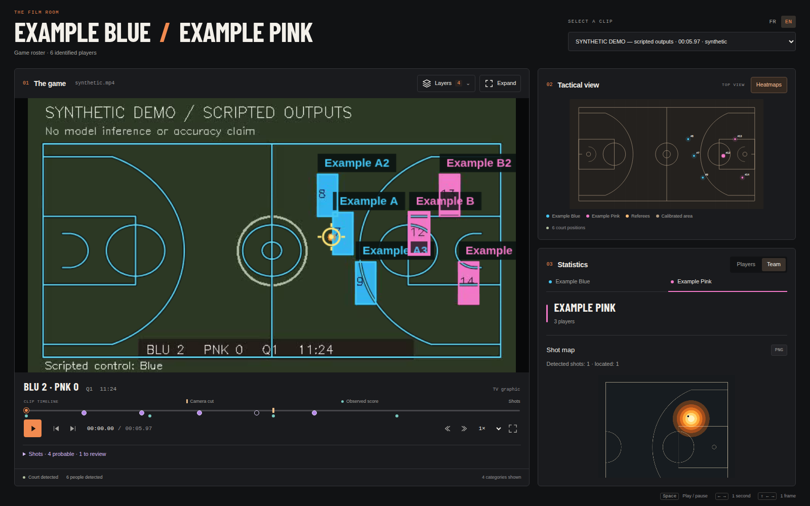

# Cartes de tirs par équipe et compteurs joueurs

L’onglet **Équipe** affiche une carte des tirs de l’équipe sélectionnée sur un
demi-terrain, panier attaqué à droite. Chaque fiche joueur ajoute seulement le
**nombre de tirs détectés**, au-dessus des mesures de déplacement.

Les deux vues utilisent les mêmes **événements probables** du détecteur. Les
candidats à vérifier restent dans la timeline et son volet de relecture, sans
entrer dans les cartes ni les compteurs joueurs. Ces valeurs décrivent les
propositions attribuées sur **l’extrait entier**, pas des statistiques officielles
ni des tirs réussis. Chercher dans la vidéo ne change pas le bilan.

## Position de départ et comptage

- La position d’un tir est la médiane des positions au sol du **tireur associé**
  dans les 0,25 s précédant le départ estimé. Il faut au moins deux positions
  calibrées, dans le terrain, du même track et de la même équipe, sans ambiguïté.
  Une coupe interrompt cette recherche. Un changement de méthode de point au sol
  ou une dispersion supérieure à 1,25 m rend la position indisponible.
- Le ballon aérien ne sert jamais à fabriquer une position métrique de tir.
  Les observations invalides ne sont pas ramenées artificiellement sur la ligne.
- Le sens provient des côtés appris par plan et quart-temps, avec contrôle des
  angles inversés. Une rotation de 180° replace le panier attaqué à droite, puis
  seul le demi-terrain correspondant est affiché. La position du joueur sur un
  côté ne suffit pas à deviner quel panier il attaque.
- Un tir sans position ou sans sens établi **reste compté**, mais ne crée ni point
  ni chaleur. La carte indique combien sont localisés et combien ne le sont pas.
- Une identité nominative absente n’empêche pas le comptage et la carte d’équipe
  lorsque l’équipe est connue. Un événement sans équipe reste explicitement hors
  des cartes. Il n’est affecté à aucun joueur pour faire coïncider les totaux.
- Le compteur joueur est indépendant de la disponibilité des distances. Zéro
  signifie aucun **tir probable attribué** ; `—` signifie données de tir ou
  effectif nominatif indisponibles. Les candidats ne s’ajoutent pas au compteur.

La grille métrique compte les tirs une fois chacun. Le rendu continu reprend
les paliers de couleur des autres heatmaps, avec un écart type spatial de 0,85 m
et une grille d’environ un mètre. L’échelle en **tirs/m² est commune aux équipes**,
sans renormaliser chaque équipe à 100 %. Les cercles montrent les positions
estimées ; le survol donne le nombre proche et les timestamps, ou le nombre par
maille. L’export PNG reprend le total, le nombre placé, le périmètre de l’extrait,
le panier de référence et l’échelle de densité. Le dessin du demi-terrain est
partagé avec les quatre vues d’occupation existantes.

## Contrôle sur HOU–LAL

L’[export reproductible](experiment.json) prolonge le
[rapport du détecteur](../shots-2026-10-26/README.md). Les détections restent
**cinq probables et quatre candidats**, aux mêmes instants.

| Équipe | Probables attribués | Localisés sur la carte | Sans position/sens |
| --- | ---: | ---: | ---: |
| Houston Rockets | 1 | 1 | 0 |
| Los Angeles Lakers | 3 | 3 | 0 |

Le cinquième probable reste sans équipe connue et hors des cartes. Les quatre
compteurs nominatifs non nuls sont **Amen Thompson, Deandre Ayton, Luke Kennard
et Marcus Smart : un chacun**. Le suivi nominatif peut manquer un autre tir réel :
ces compteurs ne doivent pas être lus comme un relevé officiel exhaustif.

Pour le tir de Kennard, certaines positions au départ sont hors terrain ; les
positions valides juste avant le départ permettent de conserver une origine
exploitable. Aucune coordonnée du ballon ou position hors limites n’est utilisée.
Ces observations contrôlent l’intégration ; elles ne valident pas indépendamment
la précision métrique des positions ou la qualité du détecteur.

## Vérifications

- **471 tests Python réussis, 28 optionnels ignorés**, 499 découverts ;
  **30 tests JavaScript réussis**, résultat global `passed`.
- Comptage probable uniquement, absence d’identité, absence de position ou de
  sens, coordonnées hors limites, camp opposé, rotation de caméra, conservation
  du nombre de tirs, médiane avant départ et interruption à une coupe.
- L’API du run et `/api/shots` exposent les mêmes compteurs et cartes ; changement
  des observations invalidant l’index. Aucun artefact de statistiques de distance
  n’est modifié.
- Chromium : compteurs 1/0/indisponible, changement d’équipe, sens opposés donnant
  le même rendu, échelle commune, candidats exclus, localisation manquante,
  survol, PNG, FR/EN, quatre tailles et axe-core. Les parcours du lecteur, du
  score, des détections et des quatre autres heatmaps passent également.
- Docker construit ; les 27 tests du détecteur et des statistiques spatiales
  passent dans l’image Python standard en lecture seule.

Aucun entraînement, nouveau modèle ou changement de vidéo/annotation source.
L’index reste une lecture d’artefacts terminés ; les nouveaux champs sont dérivés.
La calibration, les identités et les détections gardent leurs limites précédentes.

## Reproduire

```bash
python -m viewer.shot_experiment \
  --run runs/analysis/hou-lal-sam-yolo26l-ball \
  --review reports/shots-2026-10-26/review-checkpoints.json \
  --output /tmp/shot-maps.json --compact

python -m unittest viewer.test_shots viewer.test_shot_analytics viewer.test_server -v
npm --prefix viewer run test:browser
```

Les hashes du détecteur, des fonctions spatiales et du classifieur de côtés sont
inclus dans l’export, avec ceux de la source, des observations et du roster.

## Aperçu public

L’image utilise le sample et des **événements synthétiques** destinés à vérifier
l’interface : une position par équipe, un probable sans position et un candidat
exclu. Les mouvements du sample ne sont pas une vidéo de tirs annotée ; cette
capture ne mesure aucune performance sur images NBA. Les aperçus réels restent locaux.


