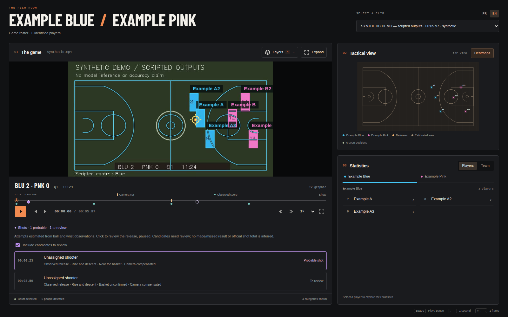

# Détection des tentatives de tir — 26 octobre 2026

Le viewer propose désormais des **événements de tir**, calculés sur les observations
existantes : repères dans la timeline, liste repliable, distinction **probable /
à vérifier**, filtre des candidats et accès à la vidéo avant le départ estimé.
Le score n’est pas un déclencheur ; marqué/raté et statistiques officielles restent
inconnus. Aucune nouvelle inférence ni dépendance ML n’est requise au runtime.

## Détecteur v1

Le chemin principal associe un départ près d’un poignet haut à un vol observé loin
des mains, puis cherche une montée et une descente cohérentes. Une réception
précoce peut écarter une passe. Les coordonnées sont recalées dans l’image de départ
à l’aide des homographies du terrain. Il s’agit d’un **recalage d’image** approximatif
pour un ballon élevé, pas d’une projection métrique de sa trajectoire sur le sol.

La courbe quadratique utilise les timestamps source ; sa courbure apparente est
normalisée par la taille d’un joueur. Ce n’est pas une mesure d’accélération en
m/s². Les positions observées absentes ne sont pas remplacées. Une coupe, exclusion,
rupture de segment, grand saut de position ou trou supérieur à 0,2 s interrompt le
vol. Une courbe après rebond ne doit pas prolonger artificiellement celle du tir.

La proximité du panier est un second indice. À partir de l’homographie et d’une
caméra supposée à pixels carrés et point principal central, le détecteur estime
un repère d’arceau élevé. Il vérifie focales et contraintes de rotation plausibles,
et renonce au repère si elles échouent. Ce n’est pas un modèle visuel d’arceau.
La hauteur de 3,048 m vient de la [règle NBA, section II(e)](https://official.nba.com/rule-no-1-court-dimensions-equipment/).
Une homographie au sol seule ne donne pas directement la position du cercle en hauteur.

| Proposition | Indices nécessaires |
| --- | --- |
| **Tir probable** | Plusieurs associations près des mains, vol majoritairement libre, arc propre, recalage disponible et rapprochement du repère de panier. |
| **À vérifier** | Arc plausible sans panier exploitable, finition partielle près du panier, ou départ masqué avec un arc et un rapprochement du panier. |

Le second chemin ne nomme aucun tireur quand le relâchement n’est pas visible.
Une identité n’est affichée que si elle appartient au roster, est unique dans
l’observation et reste cohérente autour du départ. Les contacts d’arbitre et les
mains concurrentes ne servent pas à nommer le tireur. Les propositions décrivant
le même vol sont regroupées, tout en permettant une nouvelle tentative après
un contrôle distinct. Les niveaux ne sont **pas des probabilités calibrées**.

Les principaux seuils sont exportés avec la version : ballon ≥ 0,35, trou maximal
0,2 s, fenêtre maximale 2,4 s, au moins 65 % des observations hors des mains,
approche du panier à 0,65 taille apparente de joueur, erreur quadratique ≤ 0,12
pour un arc candidat et ≤ 0,08 pour le chemin probable.

## Contrôle HOU–LAL

Source et observations sont liées par SHA-256 dans
[les checkpoints](review-checkpoints.json) et [l’export](experiment.json). Les
hashes du manifeste, roster et fichiers du détecteur sont aussi conservés.
Les images NBA restent locales. Le contrôle a utilisé des planches de frames
avant/après les départs, avec les positions de ballon observées superposées.

| Départ estimé · s source | Proposition | Lecture visuelle / réserve |
| --- | --- | --- |
| 0,93 | Probable | Finition LAL près du panier. |
| 10,83 | Probable | Finition HOU ; phase ascendante puis descendante courte. |
| 16,80 | Probable | Tir LAL en suspension. |
| 24,67 | Probable | Tir LAL en suspension. |
| 29,37 | À vérifier | Tir LAL compatible ; ancrage panier non disponible. |
| 37,50 | Probable | Tir compatible ; identité nominative non attribuée. |
| 47,57 | À vérifier | Finition LAL ; continuation/tip ultérieur ambigu. |
| 57,80 | À vérifier | Finition HOU, avec panier non confirmé par la calibration. |
| 59,10 | À vérifier | Nouvelle trajectoire près du panier ; départ masqué, tireur non attribué. |

**Bilan de contrôle : cinq probables et quatre candidats**, tous associés à l’une
des neuf fenêtres visuellement compatibles retenues. Aucune proposition ne tombe
dans les huit fenêtres négatives contrôlées : transitions, dribbles, plans serrés,
longue passe de transition et remise en jeu. Aucun événement exporté ne reste hors
de ces fenêtres de revue.

Ce bilan décrit des **points de développement choisis et utilisés pour régler le
détecteur**. Ce n’est ni une vérité terrain exhaustive du clip, ni une précision
ou un rappel sur un jeu indépendant. Un possible tip vers 48,6 s reste ambigu et
n’est pas évalué. Les lobs, contres, dunks, tip-ins très courts, ralentis et phases
hors champ restent des limites ; aucune exhaustivité n’est annoncée.

## Vérifications

- 490 tests Python découverts : **462 réussis, 28 optionnels ignorés** ;
  **30 tests JavaScript réussis**. Les contrôles globaux sont `passed`.
- Géométrie testée contre une caméra synthétique construite indépendamment :
  arceau élevé, distinction du point au sol, calibration invalide et fit temporel
  irrégulier. Aucune librairie numérique n’est nécessaire dans le viewer.
- Tests de tir, pan de caméra, ballon tenu, dribble, passe reçue, départ masqué,
  courte occultation, grand saut, coupure/exclusion/gap, contexte absent,
  identité inconnue/dupliquée/changeante et fenêtre de départ estimée.
- API commune à `/api/run` et `/api/shots`, invalidation après changement des
  observations, anciens runs et protection de la frontière des runs.
- Chromium : événements issus du détecteur sur trajectoire synthétique,
  repères pleins/creux, filtres, relecture en pause, sélection active, FR/EN,
  données manquantes, quatre tailles de liste et axe-core. Les parcours existants
  du lecteur, du score et des heatmaps restent vérifiés.
- Image Docker construite ; 18 tests de tir exécutés en Python standard dans un
  conteneur en lecture seule. Aucun entraînement ou changement de source NBA.

## Reproduire

```bash
python -m viewer.shot_experiment \
  --run runs/analysis/hou-lal-sam-yolo26l-ball \
  --review reports/shots-2026-10-26/review-checkpoints.json \
  --output /tmp/shots.json --compact

python -m unittest viewer.test_shots viewer.test_server -v
npm --prefix viewer run test:browser
```

Sans `--review`, la commande traite un autre run terminé. Les trajectoires source
par frame sont incluses sauf avec `--compact`. L’export refuse les checkpoints
qui ne correspondent pas aux hashes vidéo et observations du run.

## Aperçu public

L’interface ci-dessous utilise des **événements issus d’une trajectoire numérique
synthétique**, injectés dans le sample scripté pour vérifier l’affichage et la
navigation. Les mouvements du sample ne sont pas une vidéo de tir annotée ;
cette capture ne valide aucune performance sur images de match.


