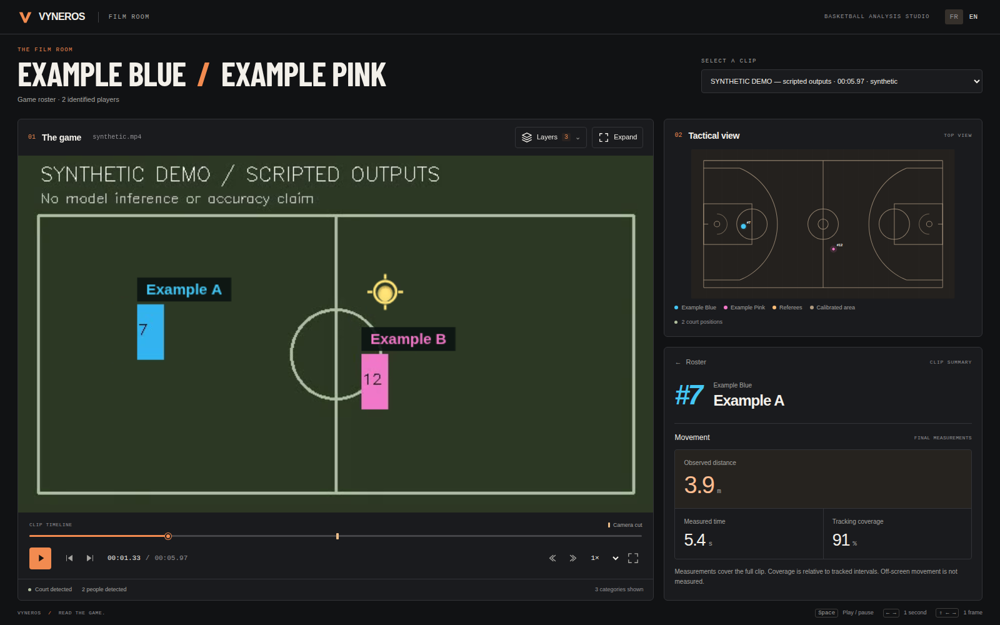

# Viewer redesign — 26 October 2026

The viewer previously exposed every layer control above the footage. Similar
card treatments, small labels and repeated CSS overrides made it hard to see
where to begin. This revision keeps the same three-panel arrangement and gives
the footage priority, with a basketball-inspired charcoal/orange identity.

## Behavior to review

- The header identifies the matchup from the roster. The local Barlow Condensed
  title font provides the sports identity without a CDN dependency.
- **Layers / Calques** groups category settings in a dismissible disclosure.
  A category count remains visible. Players and referees retain independent
  boxes, silhouettes, pose and label settings. Identified-player mode explains
  why referees are hidden. Reset restores the original defaults.
- **FR / EN** changes static copy, dynamic statuses, accessible labels, dates and
  numbers in place. It preserves playback, position, selected player and layers.
  Storage failure does not prevent using the interface.
- The tactical court uses roster team colors in its legend. It still excludes
  the ball, which has no metric ground projection in the artifacts.
- The player card groups final movement statistics under a named section and
  can scroll as more metric sections are added. Missing values remain unavailable;
  a reference-only roster never receives confirmed-player statistics.
- Desktop windows retain video left, court upper right and players lower right.
  Long rosters scroll instead of shrinking text. Compact windows use the same
  panels with document scrolling rather than a separate mobile product.

The full settings panel can cover part of the footage while open; Escape, the
close button or an outside click dismisses it. There are no additional computed
statistics, new inference behavior or changed artifact contracts.

## Public previews

Both captures use the repository’s **synthetic, scripted sample**, not learned
predictions or NBA footage.

Real HOU–LAL footage was also checked locally at 1600 × 1000 and 1280 × 720.
Local before/after, player and layers captures live in the ignored
`release/viewer-review/` directory; they are not published with the source.

## Validation

- Complete offline Python regression suites: **371 passed, 28 optional tests
  skipped** (399 discovered). No training executed. Log and summary directory:
  `runs/checks/viewer-redesign-2026-10-26/`.
- JavaScript: syntax checks for `app.js` and `i18n.js`; **17 unit regressions passed**.
- Chromium browser checks against the public sample: **1920 × 1080,
  1600 × 1000, 1440 × 900, 1366 × 768, 1280 × 720, 1024 × 768,
  820 × 900, 390 × 844**. Desktop windows fit the viewport; compact windows have
  no horizontal overflow. Layer settings remain within the viewport.
- Interaction checks: disclosure keyboard activation, Escape and focus return,
  outside click, independent layer settings, reset, identified-player mode,
  focus mode, player and team selection, paused seeking and frame stepping,
  language changes during playback, and language persistence after reload.
- Edge cases: 35-player roster with long names, missing statistics, no analyses,
  missing source video, reference roster and seeking without presentation callbacks.
- axe-core checks against WCAG 2 A/AA and 2.1 AA tags found **no automated
  violations** on the roster, layer controls and player summary. This is not a
  complete manual accessibility audit or a cross-browser certification.
- The `viewer-browser` GitHub Actions job installs the locked development-only
  dependencies, starts the scripted viewer and repeats the browser checks.
  Public sample screenshots are retained as workflow artifacts.

### Presentation-order regression found during resize checks

Chromium can call `requestVideoFrameCallback` for a paused seek destination
**before** dispatching the corresponding `seeking` event after resizing.
Unconditionally clearing on that event discarded the newly presented annotation;
no further callback arrived while paused.

The seeking handler now retains an already-presented frame when its timestamp
maps to the destination source frame. It clears previous-frame annotations in all
other cases. A regression exercises this ordering alongside the existing tests
for late annotations, rounded timestamps and delayed callbacks. No requested-frame
mask is drawn before the matching presentation callback.

## Font provenance

`viewer/BarlowCondensed-Bold.ttf` and its adjacent SIL Open Font License were
retrieved from the Google Fonts `ofl/barlowcondensed` directory on 26 October 2026.
Font SHA-256: `e476562ec9c1e16cf16475895b511f08c804f438cc9a9f80a44ea50a0eeb5b65`.

Human visual approval is pending. The feature branch must not be merged before
Erwan validates the result.
